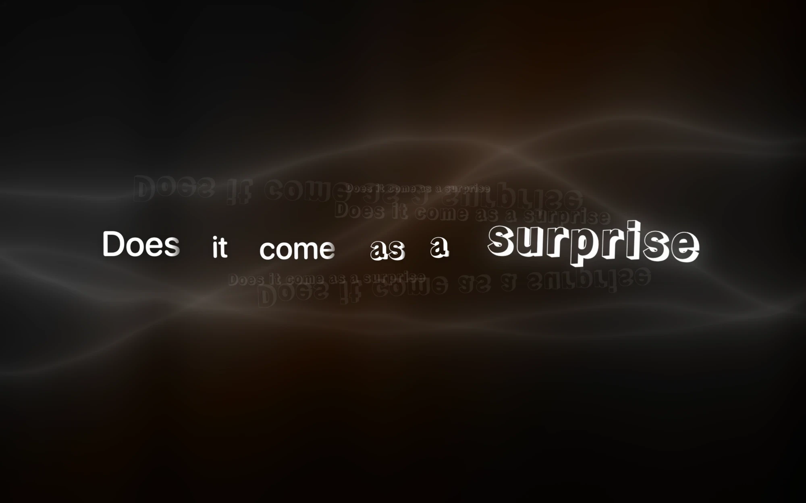
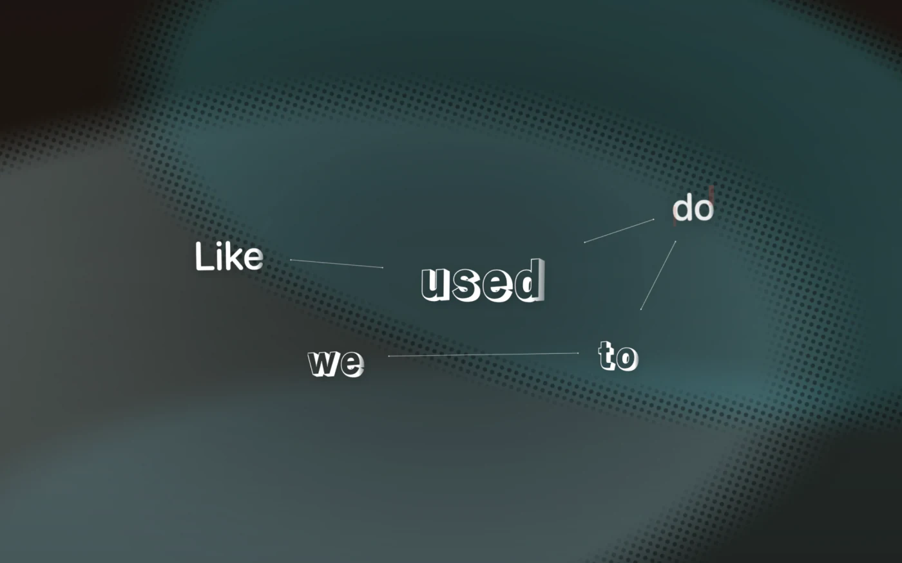
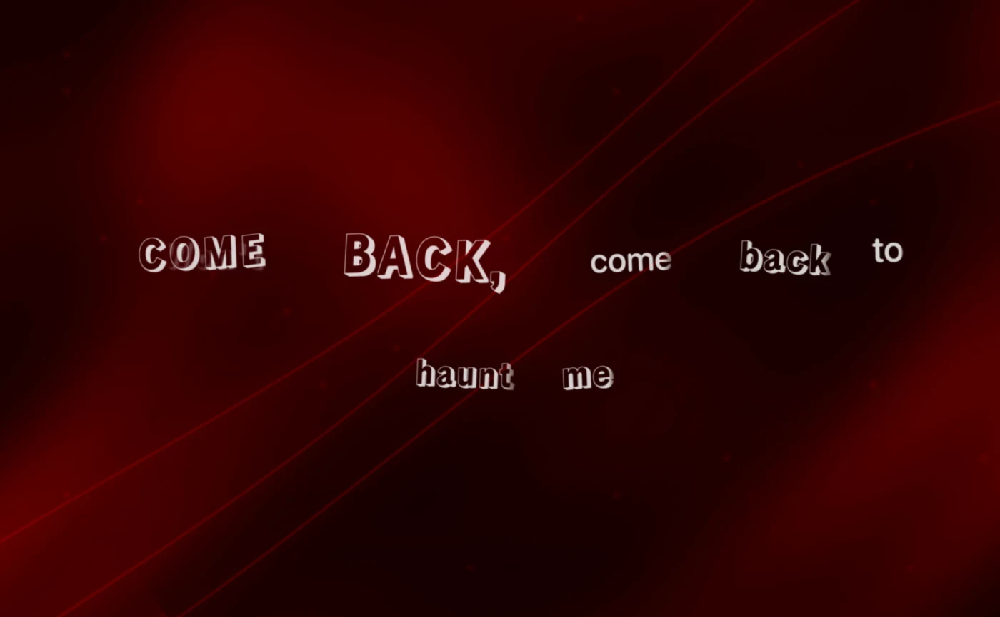
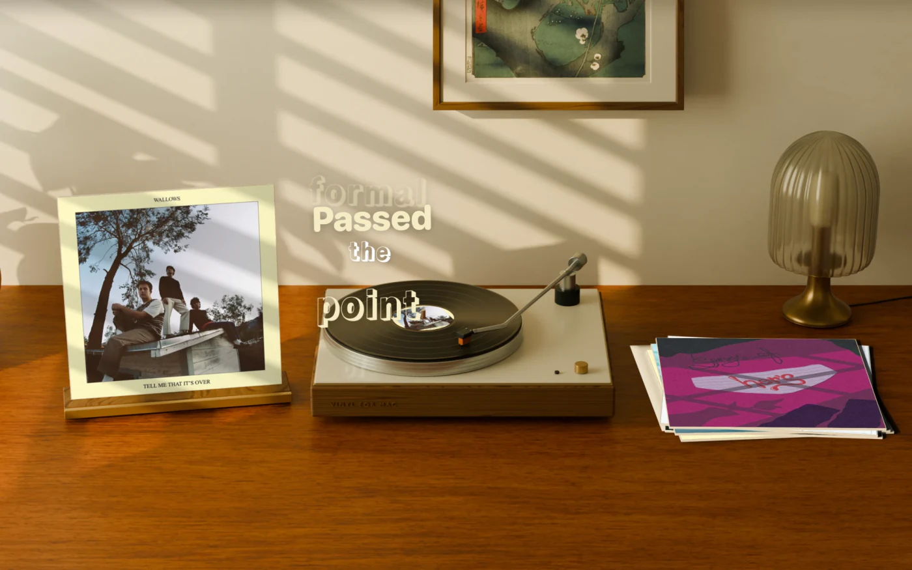
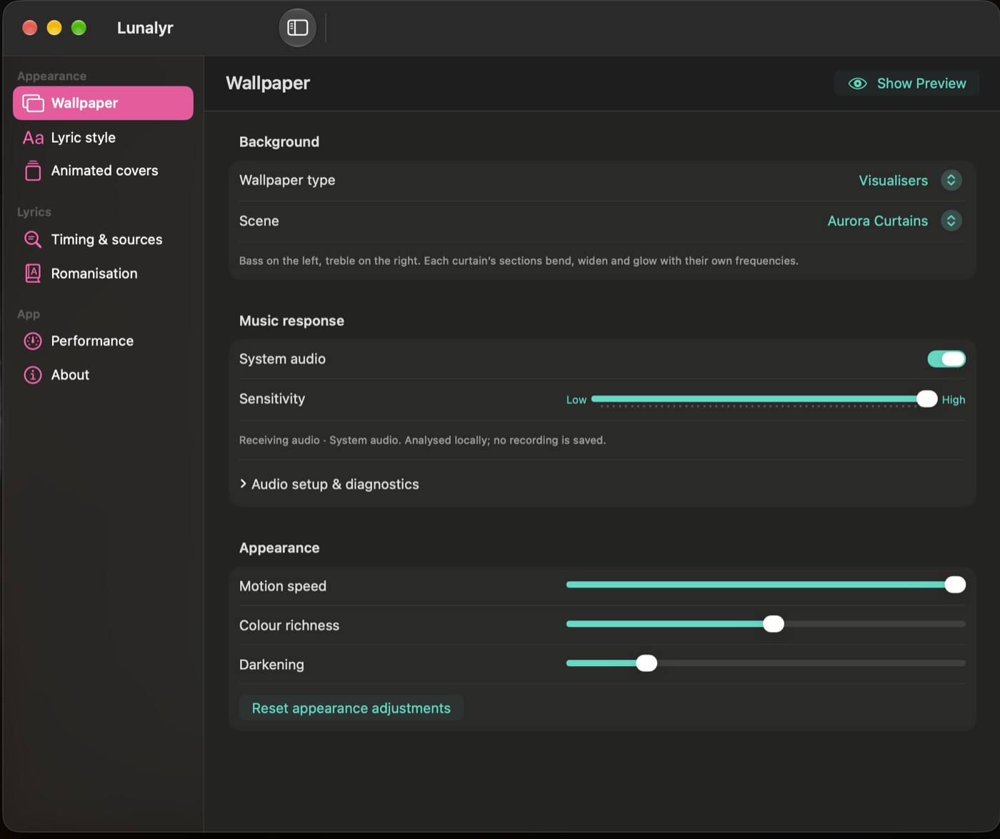
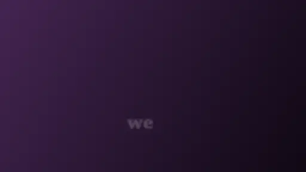
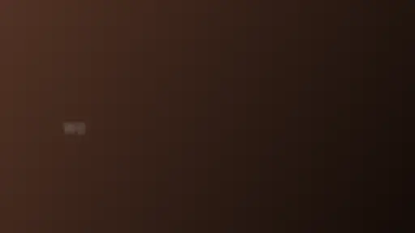
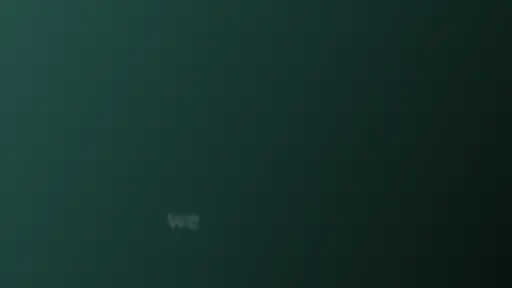
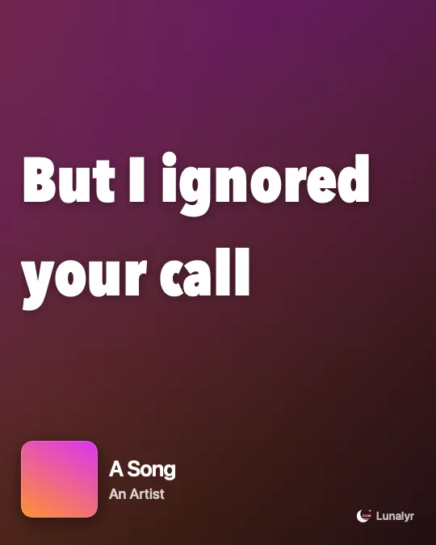

<p align="center">
  
</p>

<h1 align="center">Lunalyr</h1>

<p align="center">
  <strong>Word-timed Apple Music lyrics, set across your Mac's desktop.</strong><br>
  Animated typography over ambient GPU scenes, album colours or live audio visualisers.
</p>

<p align="center">
  <a href="https://github.com/WaterBotol/Lunalyr/actions/workflows/macos.yml"></a>
  <a href="https://github.com/WaterBotol/Lunalyr/releases/latest"></a>
  
  <a href="LICENSE"></a>
</p>

<p align="center">
  <a href="https://github.com/WaterBotol/Lunalyr/releases/latest"><strong>Download</strong></a> ·
  <a href="#install">Install</a> ·
  <a href="#quick-start">Quick start</a> ·
  <a href="#troubleshooting">Troubleshooting</a> ·
  <a href="CHANGELOG.md">Changelog</a> ·
  <a href="CONTRIBUTING.md">Contributing</a>
</p>

<p align="center">
  
</p>

Lunalyr turns your desktop into a live lyric display for Apple Music. It follows what the Music app is playing and sets each word on your wallpaper as it is sung: over ambient GPU scenes coloured from the album art, over your own desktop picture, or over visualisers that move with your Mac's audio. It lives in the menu bar and draws beneath your desktop icons, so there is no window to manage.

Lunalyr is free to use. It started as a fork of [Verso](https://github.com/AkkiCode06/verso) by AkkiCode06.

## Screenshots

<table>
  <tr>
    <td width="50%"></td>
    <td width="50%"></td>
  </tr>
  <tr>
    <td align="center"><b>Constellation</b></td>
    <td align="center"><b>Aurora Curtains visualiser</b></td>
  </tr>
  <tr>
    <td width="50%"></td>
    <td width="50%"></td>
  </tr>
  <tr>
    <td align="center"><b>Your wallpaper</b>: lyrics over the desktop you already have</td>
    <td align="center"><b>Settings</b></td>
  </tr>
</table>

## Layouts

Every layout, set to the same lyric. Pick one in **Settings → Lyrics**, or let **Match the music** choose per song. These clips are rendered from Lunalyr's own layout code over a sample background; on your desktop they sit over your wallpaper.

### Calm

<table>
  <tr>
    <td width="50%"></td>
    <td width="50%"></td>
  </tr>
  <tr>
    <td align="center"><b>Scattered</b></td>
    <td align="center"><b>Constellation</b></td>
  </tr>
  <tr>
    <td width="50%"></td>
    <td width="50%"></td>
  </tr>
  <tr>
    <td align="center"><b>Constellation + Editorial</b></td>
    <td align="center"><b>Editorial</b></td>
  </tr>
  <tr>
    <td width="50%"></td>
  </tr>
  <tr>
    <td align="center"><b>Spoken</b></td>
  </tr>
</table>

### Bold

<table>
  <tr>
    <td width="50%"></td>
    <td width="50%"></td>
  </tr>
  <tr>
    <td align="center"><b>Echo</b></td>
    <td align="center"><b>Cascade</b></td>
  </tr>
  <tr>
    <td width="50%"></td>
    <td width="50%"></td>
  </tr>
  <tr>
    <td align="center"><b>Hinge</b></td>
    <td align="center"><b>Broadside</b></td>
  </tr>
  <tr>
    <td width="50%"></td>
  </tr>
  <tr>
    <td align="center"><b>Torque</b></td>
  </tr>
</table>

### Playful

<table>
  <tr>
    <td width="50%"></td>
    <td width="50%"></td>
  </tr>
  <tr>
    <td align="center"><b>Cutout</b></td>
    <td align="center"><b>Portal</b></td>
  </tr>
  <tr>
    <td width="50%"></td>
    <td width="50%"></td>
  </tr>
  <tr>
    <td align="center"><b>Mosaic</b></td>
    <td align="center"><b>Fable</b></td>
  </tr>
</table>

### Lyric cards

<p align="center"></p>

Pick lines from the playing song and make an MP4, GIF or PNG in 4:5, 1:1, 9:16 or 16:9. Put your own picture, GIF or video behind the lyrics, and add sound from the song, the video or an audio file.

## Features

- **Words in time with the singer.** Word- and syllable-timed lyrics light up as they are sung, with a karaoke sweep and swelling held notes. When a source only has line timing, Lunalyr shows whole lines rather than inventing word timing.
- **Fourteen compositions in three groups.** Calm: Scattered, Constellation, Constellation + Editorial, Editorial, Spoken. Bold: Echo, Cascade, Hinge, Broadside, Torque. Playful: Cutout, Portal, Mosaic, Fable. Each has its own word entrance and an optional faint preview of the next word, and Editorial typography can be added to any of them.
- **Credits and the title, in the background.** Producer, writer and other credits from the lyric file are shown instead of hidden, and every song opens with its title and artist. Each leaves its own way: credits lift off, the title blooms away, backing vocals sink.
- **Lyric cards.** Pick lines from the playing song and make an MP4, GIF or PNG, with your own picture, GIF or video behind them and sound from the song, the video or an audio file.
- **Wallpapers that match the song.** 27 Metal GPU effects and 18 line patterns tinted from the album art, moving album-colour gradients, Apple Music animated album covers, or an image or looping video of your own. Choose **Your wallpaper** to draw only the lyrics over your existing desktop picture.
- **Audio-reactive visualisers.** Silk Ribbons, Spectral Aurora, Spectrum Tunnel, Aurora Curtains and Fosfora Aurora respond to your Mac's sound output, analysed on your Mac.
- **Lyrics from many sources.** Lyrics+ (KPoe), NetEase Cloud Music, LRCLIB, QQ Music, Kugou, Kuwo, lyrics.ovh and local lyric exports, picked by an *Accuracy first* match. Per-song timing offsets, manual search and LRC/TTML import cover the rest.
- **Readings.** Romanisation below or instead of the lyric: Japanese readings, Mandarin pinyin with tone options, Korean and other scripts, plus Cantonese readings from exported files.
- **Instrumental interludes.** Album-coloured ribbons and a next-vocal cue fill instrumental breaks.
- **Typefaces.** Any Google Font, downloaded on demand, or SF Pro, with Editorial pairings.
- **At home on the desktop.** One wallpaper per display, playback controls that appear when you hover over exposed desktop, a menu-bar panel, launch at login, a choice of 15, 30 or 60 fps, a low-power mode, and pausing while displays sleep.
- **Built-in updates.** Install new releases from the menu bar. Update archives are signed, and the updater verifies them before installing.

## Install

You need macOS 14 Sonoma or later and the Music app. Visualisers use Core Audio system-audio capture on macOS 14.2 or later, with a ScreenCaptureKit fallback.

1. Download `Lunalyr-<version>.zip` from the [latest release](https://github.com/WaterBotol/Lunalyr/releases/latest).
2. Unzip it in Finder and move **Lunalyr.app** to your **Applications** folder *before* opening it. An app opened straight from Downloads runs from a temporary, read-only copy, and the built-in updater cannot replace it.
3. Open Lunalyr from Applications and follow the first-launch steps below.

### First launch

Releases are ad-hoc signed but not notarised by Apple, so macOS blocks the first launch. You only need to allow it once.

On **macOS 15 Sequoia or later**:

1. Open Lunalyr. When macOS says it could not verify the app, click **Done**.
2. Open **System Settings → Privacy & Security** and scroll down to **Security**.
3. Next to the message about Lunalyr, click **Open Anyway**. Confirm with your password or Touch ID, then click **Open Anyway** again.

On **macOS 14 Sonoma**, Control-click **Lunalyr.app** in Finder, choose **Open**, then click **Open** in the dialog.

If you prefer Terminal, you can remove the download quarantine from a copy you got from this repository's releases page:

```bash
xattr -dr com.apple.quarantine /Applications/Lunalyr.app
```

### Permissions

- **Automation (Music)** is required. Allow it when macOS asks whether Lunalyr may control Music. This is how it reads the current song and playback position, and how its playback buttons work. You can change it later in **System Settings → Privacy & Security → Automation**.
- **System audio** is only needed for visualisers. macOS asks the first time you turn on **System audio** in Lunalyr's Wallpaper settings. The **Screen recording compatibility** capture method needs screen recording permission instead. The **Permissions…** button next to the audio controls opens **Privacy & Security → Screen & System Audio Recording**.

### Updating and uninstalling

Click **Check for updates…** in the menu-bar panel or under **Settings → General**. Stable releases install from there; preview builds are published as GitHub pre-releases and installed manually.

To uninstall, quit Lunalyr and move it to the Bin (Trash). To remove its data as well, delete these folders and reset its preferences:

- `~/Library/Application Support/Verso Custom/Lyrics` (saved and cached lyrics)
- `~/Library/Application Support/Verso/Fonts` (downloaded fonts)
- `~/Library/Application Support/Lunalyr/Wallpapers` (imported images and videos)

```bash
defaults delete local.verso.custom
```

## Quick start

1. Open Lunalyr. It lives in the menu bar: look for its crescent icon near the clock. There is no main window, and a Dock icon appears only while the workspace is open. The workspace opens by itself the first time. To bring it back later, click the menu-bar icon and choose **Open Lunalyr**, or open Lunalyr again from Applications.
2. Play a song in Music and allow Lunalyr to control Music when asked. The lyrics appear on your desktop.
3. Click the menu-bar icon, then **Open Lunalyr**. The workspace shows a live preview of your desktop next to the settings.
4. In **Wallpaper**, choose a kind: Match the music, GPU effects, Line patterns, Colour only, Visualisers, Your wallpaper, or Imported image or video.
5. In **Typography**, choose a composition, typeface and word entrance.
6. For a visualiser, choose **Wallpaper → Visualisers**, pick a scene and turn on **System audio**. You should see *Receiving audio* and moving meters. If not, use **Permissions…** or **Reconnect**.
7. Lyrics early or late? In **Lyrics → This song**, move the offset; it is saved for that recording. Wrong lyrics? Use **Find lyrics** to search, pick another candidate, or import an LRC or TTML file.
8. In **Performance**, 30 fps is a good balance; 60 fps uses more CPU and GPU. **Low power visuals** and **Launch at login** are there too.

## Troubleshooting

<details>
<summary><b>macOS says Lunalyr can't be opened, or that it is damaged</b></summary>

Releases are not notarised, so macOS blocks the first launch; follow the [first-launch steps](#first-launch). If macOS says the app is damaged, unzip the download again with Finder, since some third-party unarchivers break the app's signature. Then move it to Applications and, if needed, clear the quarantine flag with the `xattr` command shown there.

</details>

<details>
<summary><b>I can't find the menu-bar icon</b></summary>

Lunalyr has no Dock icon while its workspace is closed. On a MacBook with a notch, menu-bar icons can disappear behind the notch when the menu bar is crowded: quit a few other menu-bar apps, or use a menu-bar manager. You can always open the workspace by opening Lunalyr again from Applications or Spotlight.

</details>

<details>
<summary><b>No lyrics appear</b></summary>

- Lunalyr follows the Music app. Make sure a song is playing there.
- Check that Lunalyr may control Music, in **System Settings → Privacy & Security → Automation → Lunalyr → Music**. If you declined the prompt and Lunalyr is not listed, run this in Terminal and open Lunalyr again to be asked once more:

  ```bash
  tccutil reset AppleEvents local.verso.custom
  ```

- The menu-bar panel shows which source supplied the lyrics. If none did, use **Find lyrics** in the Lyrics settings to search by hand, turn on more sources, or import an LRC or TTML file.

</details>

<details>
<summary><b>Lyrics are early or late</b></summary>

Use **Earlier** and **Later** under **Lyrics → This song**. The offset is saved for that recording. **Lyrics → Advanced timing** has a global offset that applies to every song.

</details>

<details>
<summary><b>The visualiser doesn't react to music</b></summary>

- Turn on **System audio** in **Wallpaper → Music response**, and look for *Receiving audio* with moving meters.
- Click **Permissions…** and check that Lunalyr is allowed under **Screen & System Audio Recording**. Releases are ad-hoc signed, so macOS can forget this permission, and the Automation permission, after an update. Turn Lunalyr off and on again in that list, or remove and re-add it, then click **Reconnect**.
- Try the other capture method: **System audio** or **Screen recording compatibility**.
- If you report a bug, include the text from **Copy audio diagnostics**.

</details>

<details>
<summary><b>Check for updates doesn't work</b></summary>

Make sure Lunalyr is in your Applications folder and was opened from there. An app opened from Downloads runs from a temporary, read-only copy that the updater cannot replace. Move it, open it again and check once more. You can also download the [latest release](https://github.com/WaterBotol/Lunalyr/releases/latest) by hand.

</details>

<details>
<summary><b>Lunalyr uses a lot of CPU, GPU or battery</b></summary>

In **Performance**, choose 30 fps, turn on **Low power visuals**, and consider **Pause fully covered wallpapers**. Visualisers and GPU effects cost more than line patterns, colour gradients or Your wallpaper. Close the workspace window when you are not using it, because its live preview renders too.

</details>

Still stuck? [Open a bug report](https://github.com/WaterBotol/Lunalyr/issues/new/choose).

## Accessibility

- **Reduce Motion.** When **Reduce motion** is on in **System Settings → Accessibility**, most word entrances become simple fades, Spoken, Cascade and Cutout step from word to word instead of gliding, and interlude graphics stay still. Except for word-timed lines in Spoken, Cascade and Cutout, each line still fades in and out with a slight rise and a small change in size, and blurs slightly as it leaves. Visualisers slow to about 15% speed and stop reacting to beats; other wallpapers keep moving as usual. For a calmer background, choose Your wallpaper, Colour only or a line pattern, and lower **Generated motion speed**.
- **Light and motion sensitivity.** Visualisers move continuously, and their light and colour change with the music. GPU effects also move continuously but do not react to audio. Flashes, camera jolts and flashing stars are turned off, but if motion or changing light affects you, avoid the visualisers and use one of the calmer backgrounds above.
- **Text size.** **Lyric size** in Typography scales every composition, after Lunalyr fits each line to the screen.

## Lyrics sources and privacy

### Where lyrics come from

| Source | Timing | Notes |
| --- | --- | --- |
| Local exports | Word or line, with readings | LRC, `.roma.lrc`, TTML and YRC files exported by [Lyrimuse](https://github.com/Yudaotor/lyrimuse) into a folder you choose. Read-only; off by default. |
| Lyrics+ (KPoe) | Word or syllable | |
| NetEase Cloud Music | Word or line | |
| LRCLIB | Word or line | |
| QQ Music | Line | |
| Kugou Music | Line | |
| Kuwo Music | Line | |
| lyrics.ovh | Plain text | Fallback when nothing timed is found. |

By default, **Accuracy first** rejects results whose title, artist or duration do not match the recording. It then keeps the best timing available: complete word timing, then mixed, line timing and plain text. Among equally timed results, a word-timed LRCLIB result is preferred, then the closest title and artist match, then the source order above. In **Lyrics** you can reorder or disable sources, pin a particular result to a song, or choose by **Source order**. For a strict source order, also turn off **Prefer real word timing across sources** and **Prefer LRCLIB with real word timing**. Most of these services are unofficial, so availability varies. Lunalyr does not use speech recognition or vocal separation.

### What stays on your Mac

Lunalyr has no accounts, analytics or telemetry and does not access your Apple Account. It reads the current track from Music, Spotify, VLC, Swinsian or VOX through AppleScript, only while that player is already open (it never opens one). For VLC, Swinsian and VOX, a file without tags is named from its file name, and that name is what is sent to lyric sources as the title and artist. Audio for the visualisers is analysed in memory on your Mac: nothing is recorded, saved or uploaded, and the microphone is never used.

The desktop player (**Show player on hover**) also works with your Music library, on your Mac: it searches the library for what you type, reads the covers of the songs in its strip from the library, and shows the playing playlist around the current song. When you click a song in the strip, it makes a playlist called "Lunalyr Queue" with that song and the ones after it, copied from your library, and plays it. It replaces only the "Lunalyr Queue" playlist it made itself; it never deletes or changes anything else in your library, and never adds songs to it. Songs from other sources, such as Apple Music playlists or radio, simply play.

With **Follow web players in browsers** on (off by default), Lunalyr also reads YouTube Music, SoundCloud and Amazon Music tabs in Safari, Chrome, Arc, Brave or Edge. It does this by running a small script in those music tabs through AppleScript, which needs the browser's **Allow JavaScript from Apple Events** setting; Lunalyr explains how to turn it on and never changes it itself. The script reads the song, artist, album, position and cover address from the page, and play, pause, next, previous and seek go through the page's own player controls. To find music tabs, Lunalyr reads the addresses of the browser's open tabs; nothing else in other tabs is read or run. The song's details are then used like any other player's, and the cover is loaded from the address the page gives.

The music-video wallpaper (**Music video**, off by default) first looks for a music video in your Music library on your Mac.

Lunalyr contacts these services:

- **Lyric sources you have enabled** receive the song's title and artist; some also receive the album and duration.
- **Apple's iTunes Search API** receives the artist with the album or song title for each new album you play, so Lunalyr can look for an animated cover. If it finds the album, Lunalyr also loads its public Apple Music page. This happens even when **Use animated covers** is off. The API is also used to find artwork that Music does not provide. Animated covers stream from Apple's servers while they are shown.
- **Apple's iTunes Search API** also receives, from the desktop player, the words you type in its search box (for Apple Music songs and albums), and the title and artist of a song in the strip whose cover is not in your library.
- **Discord**, only when **Show what I'm listening to on Discord** is on, receives through its desktop app on your Mac the song, artist and album, the line being sung (or what you chose to show) and the progress. These appear on your profile for others. With **Show the album cover**, the cover is found on Apple's iTunes Search API, which receives the song's title and artist. With **Show a Play this song button**, your profile shows a public song.link address for the song: built from Spotify's own track ID, or, for Apple Music, from the same Apple search (only when the result is exactly that song). With both the cover and the button off, nothing is sent to Apple for Discord or for listen-along. Turning Discord off also stops your display name being sent to a listen-along relay. With **Show a Join button on Discord**, the Join invite carries your listen-along room code and your Discord display name. song.link is not contacted by Lunalyr, only by whoever clicks the button.
- **YouTube**, for the music-video wallpaper only. With **Search YouTube for videos** on (off by default), YouTube's search page (www.youtube.com) receives the song's title and artist with "official music video"; the answer for each song is remembered on your Mac. Any YouTube video shown, found or pasted, plays muted in YouTube's embedded player, which loads its script from www.youtube.com and the video from youtube-nocookie.com in a private web view that keeps no cookies. To set a YouTube video's timing, with **Search YouTube for videos** on, Lunalyr also loads that video's watch page and caption text from www.youtube.com, sending only the video's ID; the captions are compared with the song's lyrics on your Mac, and the result is remembered there. A video from your library plays on your Mac and contacts nothing; to set its timing, its soundtrack is read from the file on your Mac (never played) and compared in memory with the visualisers' system audio, only while that is already on.
- **Your listen-along relay**, only after you enter its address in **Settings › Share** (empty by default, which hides listen-along and connects nothing). The relay is a small server you deploy yourself (see [`relay/README.md`](relay/README.md)); addresses must use https, except a relay on this Mac.
  - With **Let friends listen along** on (off by default), the relay receives the song, artist, album, duration, its Spotify track ID, whether it is playing, and the position; your Discord display name while **Show what I'm listening to on Discord** is on; and, with **Share lyrics with listeners** (on by default), the lyric lines you see with their timing, once per song. Apple's catalogue ID is included only when Discord's cover or Play this song button already looked the song up; sharing never sends anything to Apple itself. The relay keeps only the latest state, and deletes it when you stop sharing or 10 minutes after Lunalyr disconnects. Anyone with the room's link or code can read that state, on the relay's web page or from its `/rooms/<code>/state` address.
  - Following a friend (from Discord's **Join** or a code in the menu bar) connects to your relay only after you accept "Listen along with …?". Lunalyr then plays their songs on your Music (songs in your library, found by searching it on your Mac) or Spotify, and turns shuffle off until you stop. Pausing or changing the music yourself pauses following until you click **Resume**, and a song is never started while your friend is paused.
  - The relay's web listen-along page, opened by people without Lunalyr, asks Apple's iTunes Search API and song.link's API (api.song.link) for the song's cover and links, and loads Spotify's embedded player only when the visitor clicks **Start listening**. Those requests come from the visitor's browser, not from your Mac.
- **Google Fonts** supplies the default interface and lyric typeface, Manrope, and any Google Font you choose. Downloaded fonts are kept on your Mac.
- **GitHub** serves update information, only when you click **Check for updates…**. Automatic checks are off, and no system profile is sent.

Preferences are stored in the `local.verso.custom` defaults domain. Lyrics, fonts and imported wallpapers are stored in the folders listed under [Updating and uninstalling](#updating-and-uninstalling).

## Build from source

You need Xcode 16 or later with its Metal toolchain, [XcodeGen](https://github.com/yonaskolb/XcodeGen) and Python 3.9 or later. The build needs the macOS 15 SDK that ships with Xcode 16, which in turn needs macOS 14.5 or later. The app itself still runs on macOS 14.

```bash
git clone https://github.com/WaterBotol/Lunalyr.git
cd Lunalyr
brew install xcodegen
bash Scripts/test.sh
bash Scripts/build.sh
python3 -m unittest discover -s Tests/Python
```

`Scripts/test.sh` generates the Xcode project and runs the XCTest suite. `Scripts/build.sh` runs the C test suites, builds the Release app into `Build/Lunalyr.app` and checks its Metal library and updater framework. The Python tests cover the update and packaging helpers. If the Metal compiler is missing, run `xcodebuild -downloadComponent MetalToolchain`.

To work in Xcode, run `xcodegen generate --spec project.yml` and open `VersoCustom.xcodeproj`. The project is generated from [`project.yml`](project.yml) and is not committed.

> [!NOTE]
> **Why `VersoCustom`?** The Xcode project, target, scheme and Swift module are still called `VersoCustom`, and the bundle identifier is still `local.verso.custom`. These names date from the Verso fork. They are kept so existing installations keep their preferences and saved data and continue to receive updates, which is also why some storage folders keep their old names.

More documentation lives in [`docs/`](docs/README.md): the [architecture overview](docs/ARCHITECTURE.md), the [release process](docs/RELEASING.md), [validation records](docs/VALIDATION.md) and [external formats and system APIs](docs/INTEROPERABILITY.md).

## Contributing

Bug reports, ideas and pull requests are welcome. Start with [CONTRIBUTING.md](CONTRIBUTING.md), and please follow the [Code of Conduct](CODE_OF_CONDUCT.md). Report security problems privately, as described in [SECURITY.md](SECURITY.md).

## Acknowledgements

Lunalyr is built on [Verso](https://github.com/AkkiCode06/verso) by Akki ([AkkiCode06](https://github.com/AkkiCode06)), which provides its lyric engine, compositions and GPU effects. Verso's original README is kept in [docs/upstream](docs/upstream/README.md).

Lunalyr also relies on:

- [Synesthia](https://github.com/jonjaques/synesthia) by Jon Jaques (MIT) for the FFT analyser and the aurora and tunnel shaders behind Silk Ribbons, Spectral Aurora and Spectrum Tunnel.
- [Fosfora](https://github.com/kevinraymond/fosfora) by Kevin Raymond (MIT) for the Aurora shader behind Fosfora Aurora.
- [Sparkle](https://sparkle-project.org) (MIT) for updates.
- [Yams](https://github.com/jpsim/Yams) and libyaml (MIT) for LRCLIB's YAML lyric files.
- [XcodeGen](https://github.com/yonaskolb/XcodeGen) for project generation, and [Google Fonts](https://fonts.google.com) for typefaces.
- Lyric data from [Lyrics+](https://github.com/ibratabian17/LyricsPlus), [LRCLIB](https://lrclib.net), NetEase Cloud Music, QQ Music, Kugou, Kuwo and lyrics.ovh, and the [Lyrimuse](https://github.com/Yudaotor/lyrimuse) export formats. Lunalyr is not affiliated with any of these services.
- The [Cotodama Lyric Speaker](https://lyric-speaker.com/), which inspired Verso.

Full notices are in [THIRD_PARTY_NOTICES.md](THIRD_PARTY_NOTICES.md), and the licence texts are bundled with the app.

## Licence

Lunalyr is licensed under the GNU General Public License v3.0 with the Commons Clause licence condition, unchanged from Verso. See [LICENSE](LICENSE). The GPL lets you use, study, share and modify the code. The Commons Clause adds that you may not sell the software, or a product or service whose value derives substantially from it. The LICENSE file is the authoritative text.

Apple Music and Music are trademarks of Apple Inc. Lunalyr is not affiliated with or endorsed by Apple.
