<p align="center">
  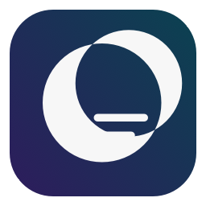
</p>

<h1 align="center">Lunalyr</h1>

<p align="center">
  <strong>The words to your music, sung across your Mac's desktop.</strong><br>
  Time-synced lyrics as a living wallpaper, word by word, in the colours of the song.
</p>

<p align="center">
  <a href="https://github.com/WaterBotol/Lunalyr/releases/latest"></a>
  
  <a href="LICENSE"></a>
</p>

<p align="center">
  <a href="https://github.com/WaterBotol/Lunalyr/releases/latest"><strong>Download</strong></a> ·
  <a href="#install">Install</a> ·
  <a href="#features">Features</a> ·
  <a href="#faq-and-troubleshooting">Help</a> ·
  <a href="#privacy">Privacy</a> ·
  <a href="CHANGELOG.md">What's new</a>
</p>

[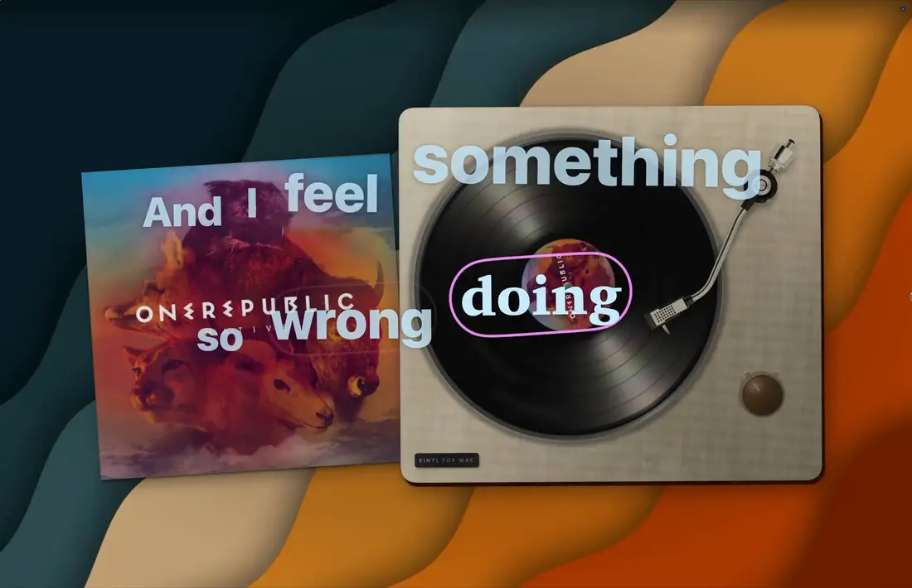](docs/media/hero.mp4)

Play a song and Lunalyr puts its lyrics on your desktop, lighting each word as it is sung. It follows Apple Music, Spotify and more, sits quietly in the menu bar, and draws beneath your desktop icons, so there is no window to manage. Prefer to see the words while you work? Float them over your apps instead. And with Discord on, your friends see the line you're hearing on your profile.

Lunalyr is free and open source. It started as a fork of [Verso](https://github.com/AkkiCode06/verso) by AkkiCode06.

> [!TIP]
> Click any animation on this page to watch it as a full-quality video.

## Features

- [Lyrics on your desktop](#lyrics-on-your-desktop)
- [Fourteen layouts](#fourteen-layouts)
- [Japanese, Chinese and Korean readings](#japanese-chinese-and-korean-readings)
- [Floating lyrics over your apps](#floating-lyrics-over-your-apps)
- [Discord and listening along](#discord-and-listening-along)
- [An opening title for every song](#an-opening-title-for-every-song)
- [Backgrounds](#backgrounds)
- [The desktop player](#the-desktop-player)
- [Lyric cards](#lyric-cards)
- [Where lyrics come from](#where-lyrics-come-from)
- [Works with the music apps you use](#works-with-the-music-apps-you-use)
- [Menu bar, keyboard shortcuts and Shortcuts](#menu-bar-keyboard-shortcuts-and-shortcuts)
- [Accessibility](#accessibility)

### Lyrics on your desktop

- **Every word in time.** Word- and syllable-timed lyrics light up as they are sung, with a karaoke sweep and held notes that swell. When a source only has line timing, Lunalyr shows whole lines rather than guessing at the words.
- **Backing vocals** written in brackets, like *(oh oh)*, drift in softly behind the lead.
- **Credits** such as "Produced by" and "Lyrics by" appear in the background instead of being mistaken for lyrics.
- **Instrumental breaks** fill with album-coloured ribbons and a cue for the next line.
- **One wallpaper per display**, with a choice of 15, 30 or 60 frames a second, a low-power mode, and pausing while displays sleep or the desktop is covered.

### Fourteen layouts

[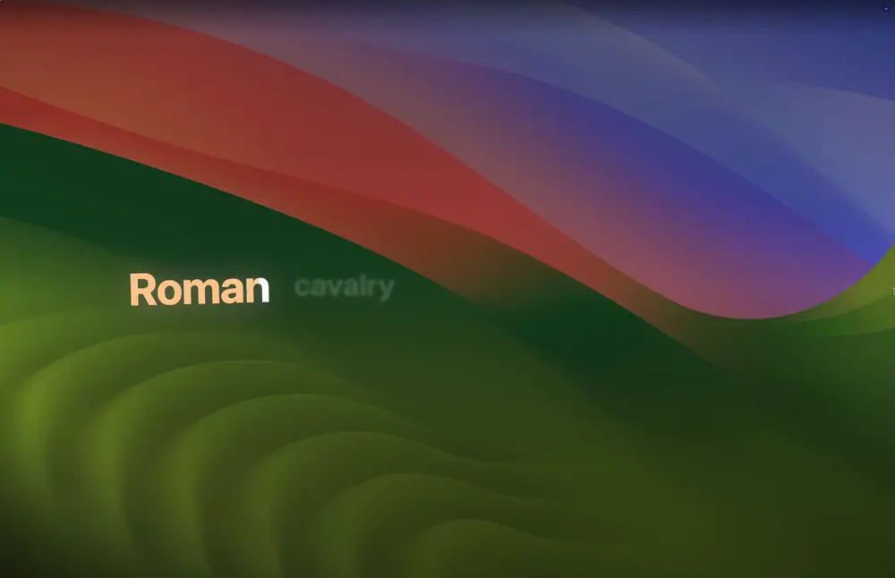](docs/media/layouts-tour.mp4)

Each layout sets the words in its own way, from calm and spacious to bold and playful. Pick one in **Settings › Lyric style**, or let **Match the music** choose one for each song. Every layout has a choice of word entrances (Float up, Pop, Orbit, Glide, Unfold and more), an optional faint preview of the next word, and an **Editorial** typography option. Use any Google Font, downloaded when you pick it, or one of the built-in typefaces. Lunalyr can remember the look you chose for a song or an artist.

<details>
<summary><b>See all 14 layouts</b></summary>
<br>

<table>
  <tr>
    <td width="50%" align="center">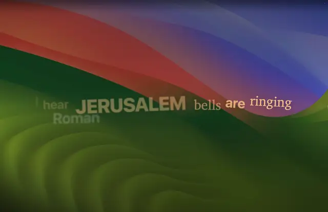<br><b>Scattered</b> · Calm<br><sub>Words set loose across the line</sub></td>
    <td width="50%" align="center">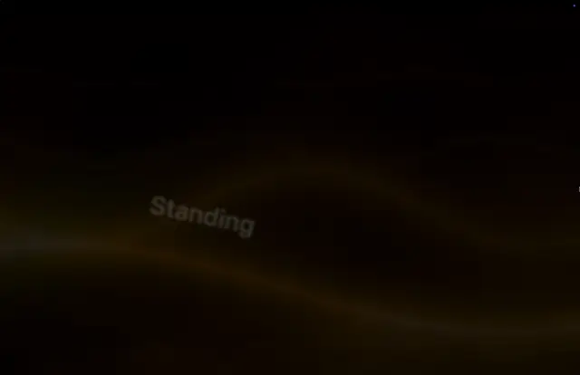<br><b>Constellation</b> · Calm<br><sub>Fragments linked by hairlines, like a star chart</sub></td>
  </tr>
  <tr>
    <td width="50%" align="center">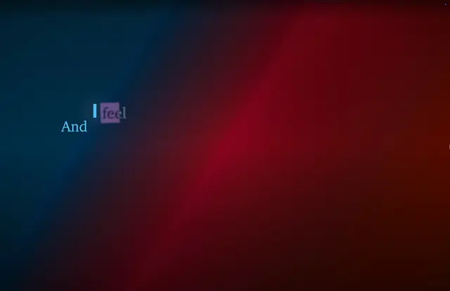<br><b>Constellation + Editorial</b> · Calm<br><sub>Linked fragments in two contrasting typefaces</sub></td>
    <td width="50%" align="center">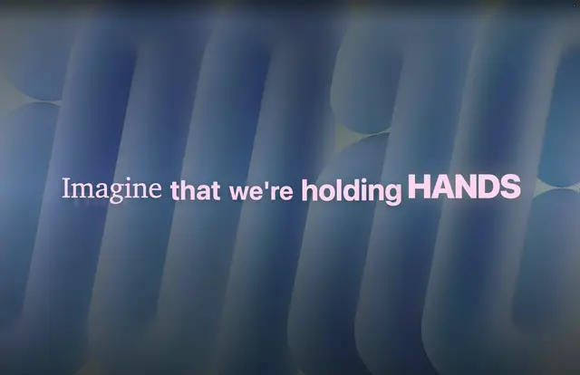<br><b>Editorial</b> · Calm<br><sub>Two typefaces in one line, set like a magazine spread</sub></td>
  </tr>
  <tr>
    <td width="50%" align="center">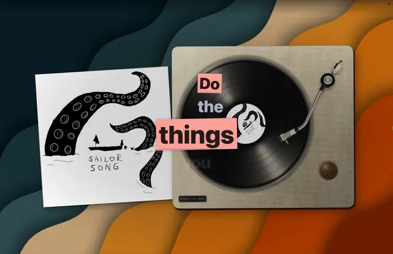<br><b>Spoken</b> · Calm<br><sub>Each sung word takes focus, recent words settle around it</sub></td>
    <td width="50%" align="center">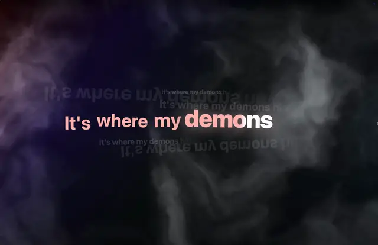<br><b>Echo</b> · Bold<br><sub>The line repeated at many sizes, some inverted</sub></td>
  </tr>
  <tr>
    <td width="50%" align="center">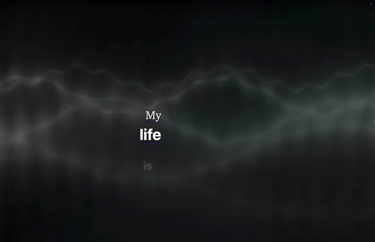<br><b>Cascade</b> · Bold<br><sub>A moving column of words, arriving with the voice</sub></td>
    <td width="50%" align="center">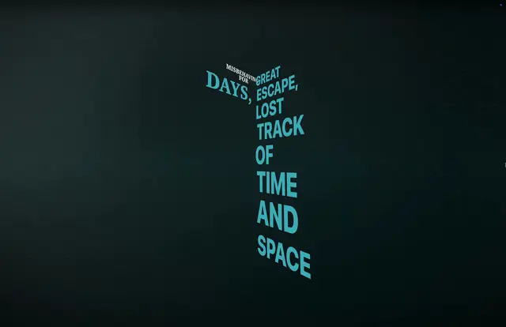<br><b>Hinge</b> · Bold<br><sub>Heavy words swing in on a hinge and fold into a stack</sub></td>
  </tr>
  <tr>
    <td width="50%" align="center">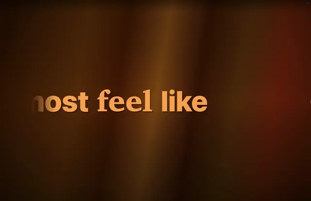<br><b>Broadside</b> · Bold<br><sub>One strip of big type that slides along</sub></td>
    <td width="50%" align="center">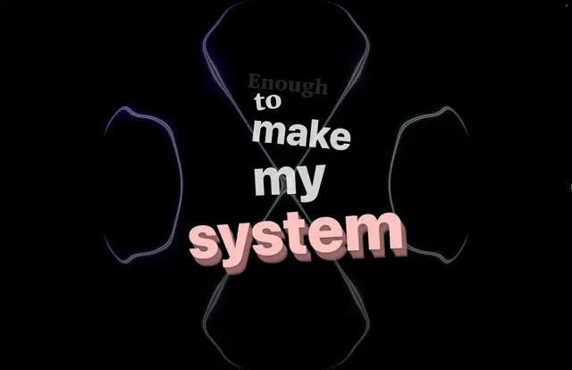<br><b>Torque</b> · Bold<br><sub>Words wrung into place with a thick edge, stacking upwards</sub></td>
  </tr>
  <tr>
    <td width="50%" align="center">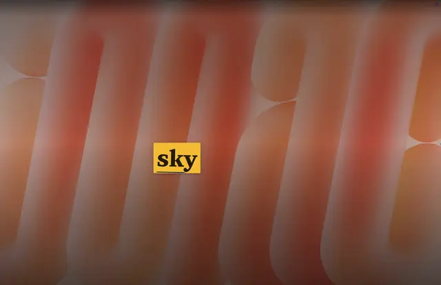<br><b>Cutout</b> · Playful<br><sub>Uneven type and album-colour labels, built word by word</sub></td>
    <td width="50%" align="center">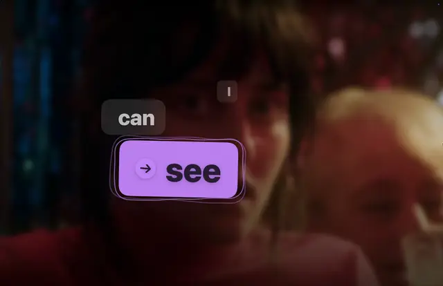<br><b>Portal</b> · Playful<br><sub>The sung word in a pill, earlier words drifting away</sub></td>
  </tr>
  <tr>
    <td width="50%" align="center">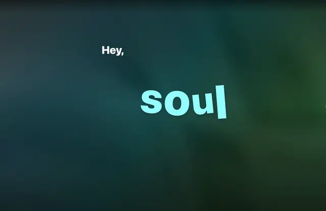<br><b>Mosaic</b> · Playful<br><sub>A collage of huge words, colour bars and single letters</sub></td>
    <td width="50%" align="center">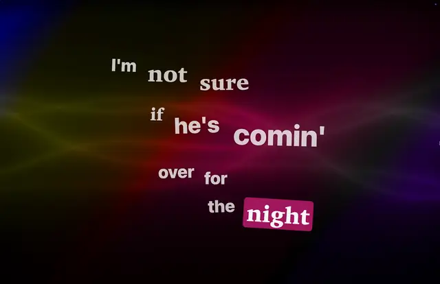<br><b>Fable</b> · Playful<br><sub>A new shape and accent every line</sub></td>
  </tr>
</table>

</details>

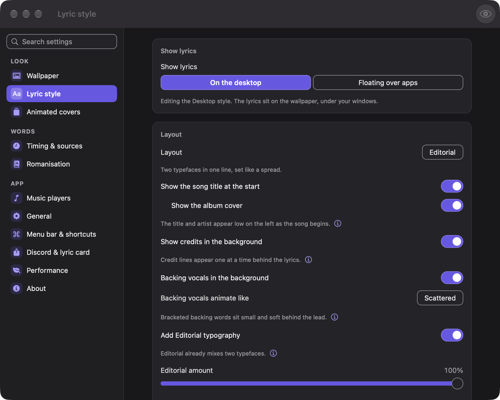

### Japanese, Chinese and Korean readings

[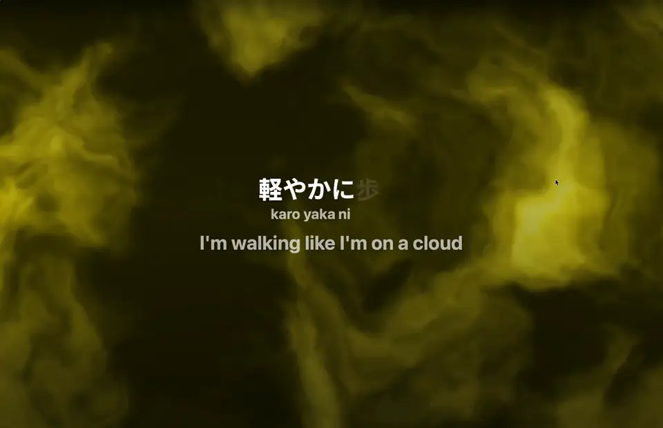](docs/media/readings-japanese.mp4)

Show a reading under the lyrics, or instead of them: romaji for Japanese, pinyin for Mandarin (with or without tone marks), Revised Romanisation for Korean, and Latin letters for other scripts. Cantonese readings come from files you import. The reading fills in syllable by syllable with the word above it, in every layout.

Lyrics in a language you don't read can also be **translated on your Mac**, with Apple's on-device Translation (macOS 15 or later, off by default). A translation from the lyric source always comes first.

### Floating lyrics over your apps

[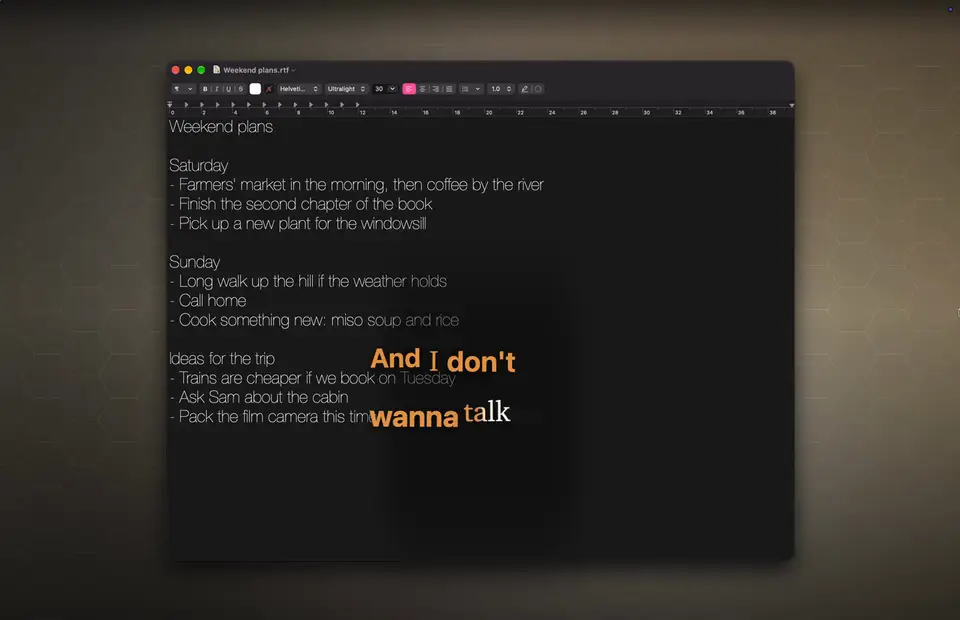](docs/media/floating-lyrics.mp4)

Choose **Floating over apps** (in **Settings › Lyric style**, or the **Floating** button in the menu bar) and the lyrics move into a see-through window above every app, full-screen ones included. Put them in a corner, the centre, under the menu bar or above the Dock, on the display you choose, or drag them anywhere with **Edit position**, and give them their own style, size and shade. Clicks pass straight through, the lyrics fade while the pointer is over them, and they hide when nothing is playing.

### Discord and listening along

Show your friends what you're listening to, line by line. With **Discord** on, your Discord profile shows the lyric being sung right now, updating as the song plays, with the album cover and a progress bar.

- **The lyric, the song or the artist**: choose what your status shows. Lyrics can run a moment ahead of the music (2 seconds by default), so friends read each line as you hear it.
- **Instrumental breaks** show "♪ Instrumental", and a paused song says so, or the status clears, as you prefer.
- **A Play this song button** opens the same song on Spotify, Apple Music, YouTube Music and more, whichever app your friends use. A **Get Lunalyr** button sits beside it.
- **It just works with the Discord app**: open Discord before or after Lunalyr and the status appears; Lunalyr keeps within Discord's limits so updates aren't dropped.
- **Listen along**: let friends follow what you play, in time, on their own Spotify or Music, or in a web page with the lyrics lit line by line, joining from a button on your Discord profile. Lunalyr doesn't run a server to pass the music between you, so this needs one you set up yourself, for free on Cloudflare; [`relay/README.md`](relay/README.md) walks through it. Until you add one, listen-along stays hidden and nothing connects.

Turn it on in **Settings › Discord & lyric card** (it's off until you do).

### An opening title for every song

[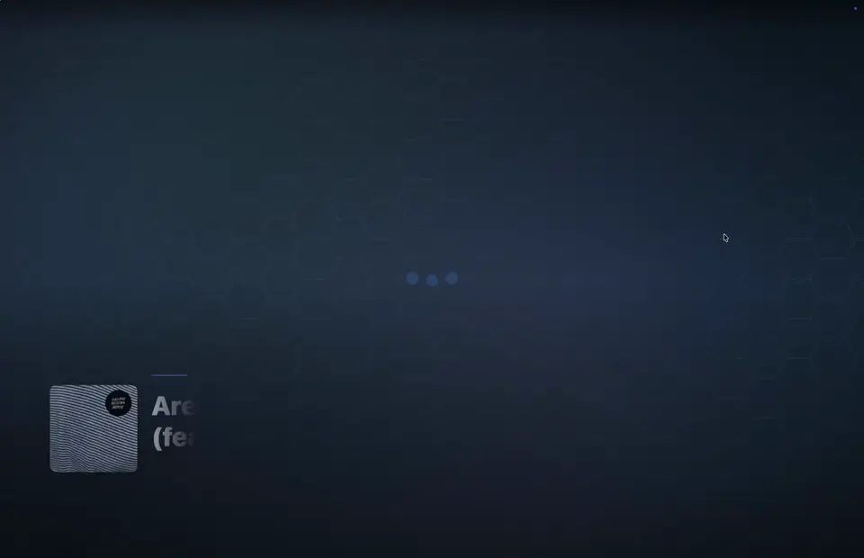](docs/media/opening-title.mp4)

As a song starts, its title, artist and album appear low on the left beside the cover, like the title card of a music video, with a reading under Japanese, Chinese or Korean titles. It leaves before the first line is sung, and the song's credits follow.

### Backgrounds

Choose what the lyrics sit on in **Settings › Wallpaper**:

- **Match the music** picks a look to suit each song's energy and feel.
- **Animated effects** (called GPU effects in Settings): 27 moving scenes, from plasma and aurora to nebulae, in the album's colours.
- **Line patterns** in the album's colours, gentle on power.
- **Colour only**: a moving gradient of the album's colours.
- **Visualisers** that move with your Mac's sound: Silk Ribbons, Spectral Aurora, Spectrum Tunnel, Aurora Curtains, Fosfora Aurora, Star Trails, Wavefield, Wavecore, Light 3D, Colour Strata, Overprint and more. The sound is analysed in memory on your Mac and never recorded.
- **Music video**: the song's own music video, muted and kept in time with the music. Lunalyr looks in your Music library first and, if you allow it, searches YouTube. You can pick a different video, paste a link, or line it up yourself by tapping or dragging.
- **Your wallpaper**: just the lyrics, over the desktop picture you already have. Other wallpaper apps keep working underneath, so a live wallpaper from an app such as Vinyl stays on show.
- **Image or video**: a picture or looping video of your own.

Apple Music's **animated album covers** can play behind the lyrics too.

<table>
  <tr>
    <td width="50%"><a href="docs/media/background-visualiser.mp4">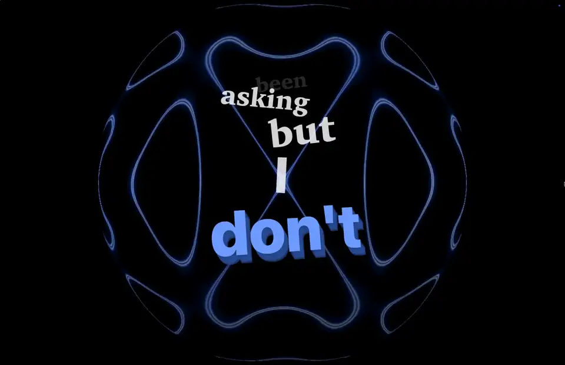</a></td>
    <td width="50%"><a href="docs/media/background-music-video.mp4">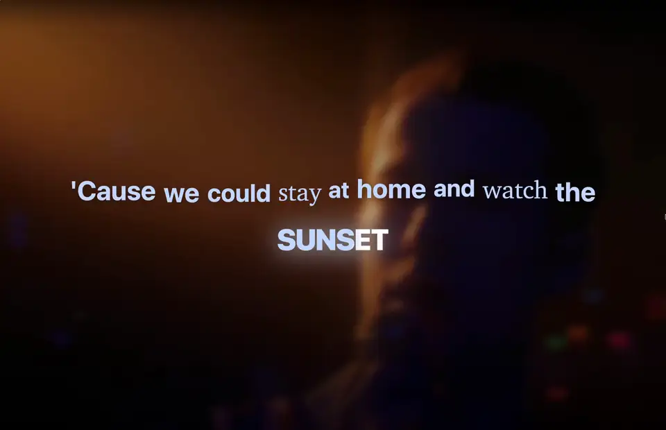</a></td>
  </tr>
  <tr>
    <td align="center"><b>Visualiser</b></td>
    <td align="center"><b>Music video</b></td>
  </tr>
  <tr>
    <td width="50%">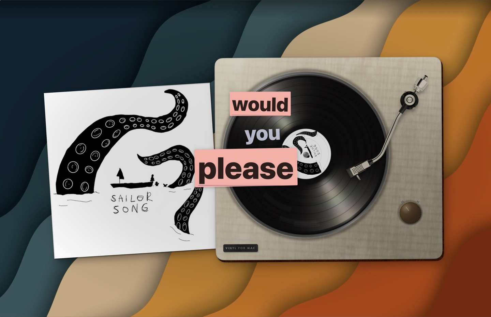</td>
    <td width="50%">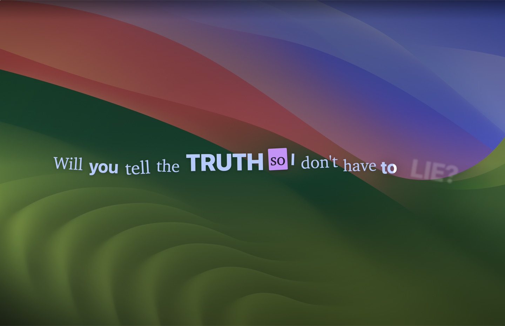</td>
  </tr>
  <tr>
    <td align="center"><b>Your wallpaper</b> · with the Vinyl app underneath</td>
    <td align="center"><b>Image or video</b></td>
  </tr>
  <tr>
    <td width="50%">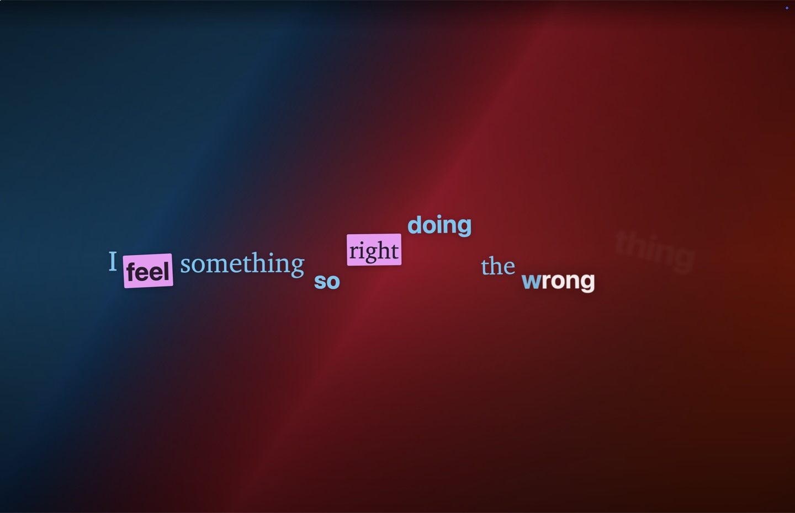</td>
    <td width="50%">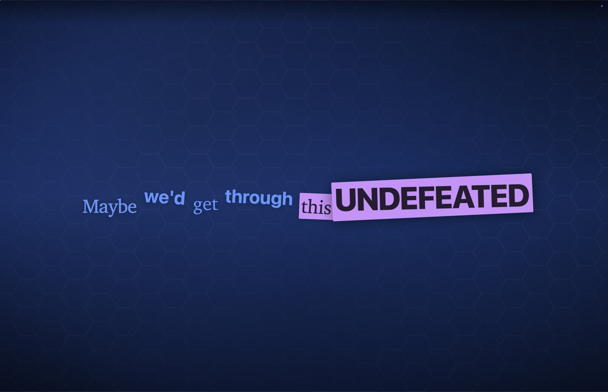</td>
  </tr>
  <tr>
    <td align="center"><b>Animated effect</b> · Plasma</td>
    <td align="center"><b>Album colours</b></td>
  </tr>
</table>

### The desktop player

<table>
  <tr>
    <td width="50%">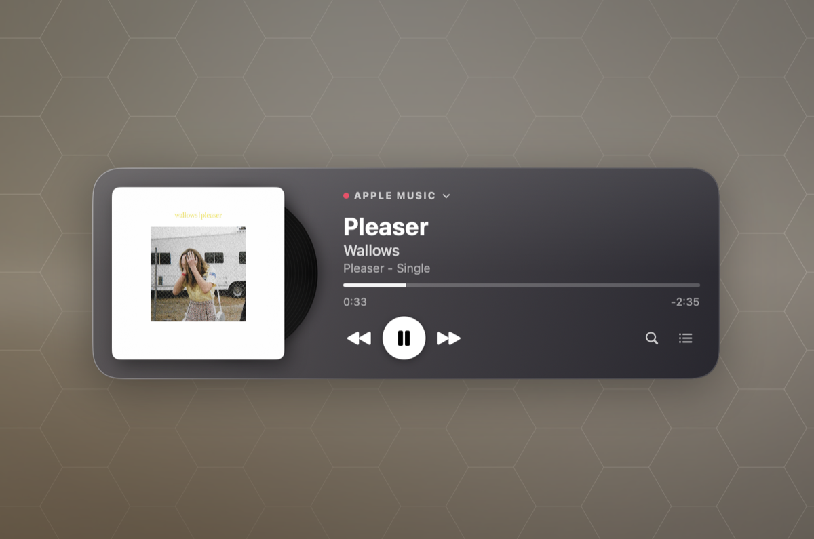</td>
    <td width="50%">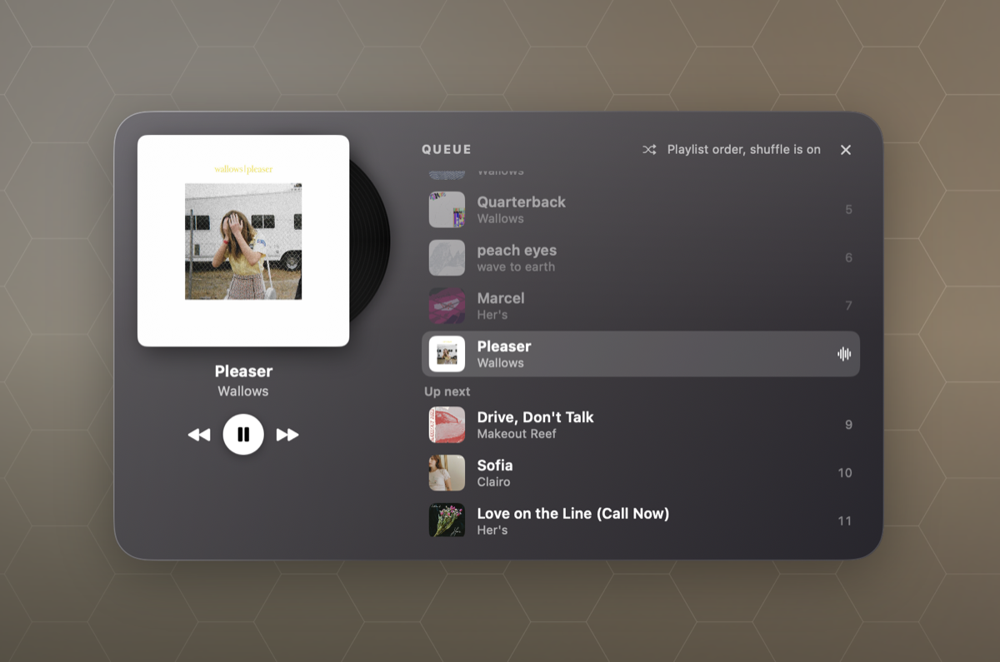</td>
  </tr>
</table>

Rest the pointer on an empty part of the desktop and **Sleeve**, the desktop player, comes up: one card washed in the album's colours, with a big cover, the song, a seek bar and the play controls. Search your library, open the queue, flick through covers, and switch between music apps. The seek bar shows the lyric line under the pointer and snaps to the start of lines. Once you click it, the keyboard works too: Space plays or pauses, the arrow keys move through the song or by lyric line, and ⌘F searches. Turn it on with **Show player on hover** in **Settings › Performance**.

### Lyric cards

<p align="center">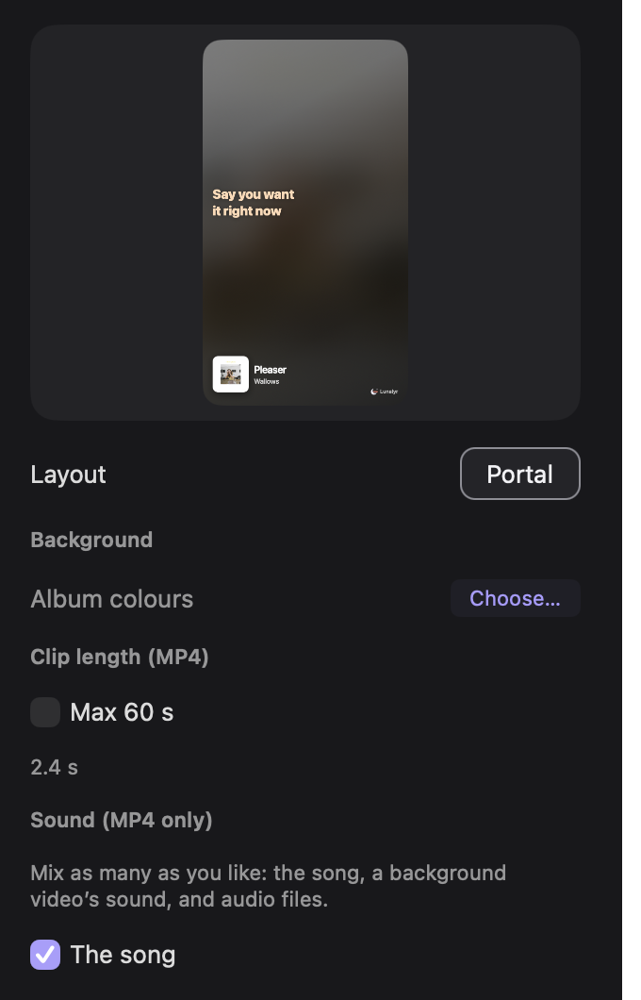</p>

Pick lines from the playing song and make a card to share, as an MP4, GIF or PNG in 4:5, 1:1, 9:16 or 16:9. Put your own picture, GIF or video behind the words, and add sound: the song itself, the background video's sound or any audio file, each with its own level.

### Where lyrics come from

Lunalyr uses the Music app's own lyrics first, then asks Lyrics+, AMLL (a community collection of word-timed lyrics), NetEase Cloud Music, LRCLIB, QQ Music, Kugou, Kuwo and lyrics.ovh, and keeps the best-timed lyrics for the exact recording you are playing. It can also read lyric files saved on your Mac by [Lyrimuse](https://github.com/Yudaotor/lyrimuse). If it picks the wrong lyrics, choose another result, search by hand, or import a lyric file of your own in **Settings › Timing & sources**.

Lyrics early or late? Nudge them for that song, or use **Tap to Sync Lyrics** in the menu bar: press any key as each line starts, and after four taps that agree Lunalyr sets the timing for you.

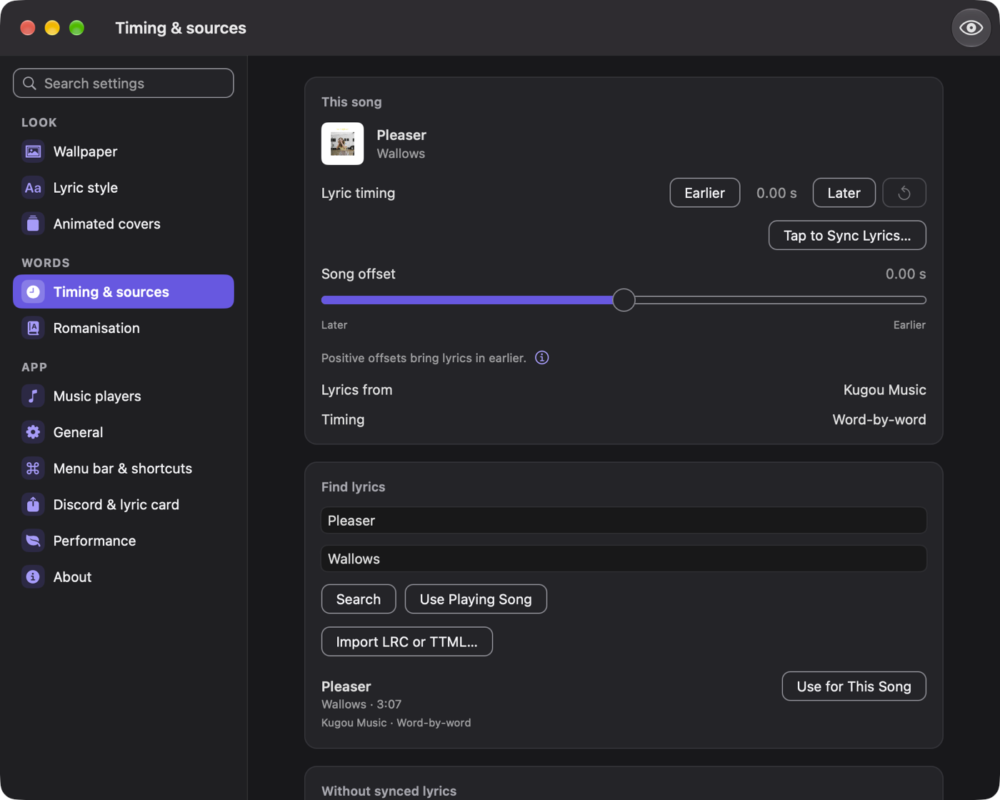

### Works with the music apps you use

- **Apple Music** and **Spotify**.
- **YouTube Music, SoundCloud and Amazon Music** playing in Safari, Chrome, Arc, Brave or Edge (off by default; see [PRIVACY.md](PRIVACY.md)).
- **VLC, Swinsian and VOX**, for music files on your Mac (off by default).

Lunalyr only reads a player that is already open; it never opens one itself.

### Menu bar, keyboard shortcuts and Shortcuts

- **The menu-bar panel** shows what is playing and where its lyrics came from, with quick switches for the wallpaper, floating lyrics, the visualiser scene and lyric timing.
- **The current line in the menu bar**, if you like.
- **Global keyboard shortcuts** (off until you turn them on in **Settings › Menu bar & shortcuts**) to show or hide the lyrics, nudge their timing, change layout, open a lyric card, pause the wallpaper, tap to sync, toggle the music video and change visualiser.
- **Shortcuts actions** for the same jobs, so you can use them in your own shortcuts or with Siri.
- **`lunalyr://` links**: `lunalyr://toggle`, `lunalyr://floating`, `lunalyr://card` and `lunalyr://settings`.

When you use one of these while the wallpaper is hidden, a small confirmation appears under the menu bar.

### Accessibility

- **Reduce Motion.** When **Reduce motion** is on in **System Settings › Accessibility**, most word entrances become simple fades and layouts dissolve between steps instead of moving words around. Visualisers slow to about 15% speed and stop reacting to beats. The desktop player drops its bending and sliding for plain fades. For a calmer background, choose Your wallpaper, Colour only or a line pattern.
- **Light and motion sensitivity.** Visualisers move continuously, and their light and colour change with the music. Flashes, camera jolts and flashing stars are turned off, but if motion or changing light affects you, use one of the calmer backgrounds above.
- **Reduce Transparency and Increase Contrast** are followed by the desktop player and Settings.
- **Text size.** **Lyric size** in Lyric style scales every layout, after each line is fitted to the screen.

## Install

1. Download `Lunalyr-<version>.zip` from the [latest release](https://github.com/WaterBotol/Lunalyr/releases/latest).
2. Unzip it in Finder and move **Lunalyr.app** to your **Applications** folder *before* opening it, so that updates can install later.
3. Open Lunalyr from Applications and follow the first-launch steps below.

### First launch

Lunalyr is made by one person without a paid Apple developer account, so it isn't notarised by Apple and macOS warns you the first time you open it. The app is open source, and the steps below just tell macOS that you trust it. You only need to do this once.

On **macOS 15 Sequoia or later**:

1. Open Lunalyr. When macOS says it could not verify the app, click **Done**.
2. Open **System Settings → Privacy & Security** and scroll down to **Security**.
3. Next to the message about Lunalyr, click **Open Anyway**. Confirm with your password or Touch ID, then click **Open Anyway** again.

On **macOS 14 Sonoma**, Control-click **Lunalyr.app** in Finder, choose **Open**, then click **Open** in the dialog.

If you prefer Terminal, you can remove the download quarantine from a copy you got from this repository's releases page:

```bash
xattr -dr com.apple.quarantine /Applications/Lunalyr.app
```

### Getting started

1. Lunalyr lives in the menu bar: look for its crescent icon near the clock. A short welcome opens the first time.
2. Play a song, and allow Lunalyr to control your music app when macOS asks. The lyrics appear on your desktop.
3. Click the menu-bar icon for quick controls, or choose **Settings…** to pick a layout, background and typeface, with a live preview beside the options.

### Permissions

- **Automation** is required. Allow it when macOS asks whether Lunalyr may control Music (or Spotify, or the other player you use). This is how it reads the current song and playback position, and how its playback buttons work. You can change it later in **System Settings → Privacy & Security → Automation**.
- **System audio** is only needed for visualisers. macOS asks the first time you turn on **System audio** in **Settings › Wallpaper**.

### Updating and uninstalling

Once a day Lunalyr checks quietly for a new stable release. When there is one, its menu-bar moon turns into a violet circle with a down arrow; click the icon and the panel opens with **Lunalyr x.y is available**. Choose **Update…** to see what's new and install it, or **Later** to bring the moon back until the next day's check (**Settings › General** keeps saying an update is waiting). Nothing is downloaded or installed until you choose to. You can also click **Check for Updates…** in the menu-bar panel or in **Settings › General** at any time, and turn off **Check for updates automatically** there. Preview builds are published as GitHub pre-releases and installed by hand.

To uninstall, quit Lunalyr and move it to the Bin (Trash). To remove its data as well, delete these folders and reset its preferences. Lunalyr's files and settings still use its original project name, "Verso Custom" (`local.verso.custom`), so these are Lunalyr's own:

- `~/Library/Application Support/Verso Custom/Lyrics` (saved and cached lyrics)
- `~/Library/Application Support/Verso/Fonts` (downloaded fonts)
- `~/Library/Application Support/Lunalyr/Wallpapers` (imported images and videos)

```bash
defaults delete local.verso.custom
```

## Requirements

- macOS 14 Sonoma or later.
- A music app Lunalyr can follow: Music, Spotify, a supported web player, VLC, Swinsian or VOX.
- Visualisers use system-audio capture on macOS 14.2 or later, with a screen-recording fallback on earlier versions.
- Translating lyrics on your Mac needs macOS 15 or later.
- Discord status needs the Discord desktop app. Listen-along needs a small server you set up yourself (see [Discord and listening along](#discord-and-listening-along)).

## FAQ and troubleshooting

<details>
<summary><b>macOS says Lunalyr can't be opened, or that it is damaged</b></summary>

Releases are not notarised, so macOS blocks the first launch; follow the [first-launch steps](#first-launch). If macOS says the app is damaged, unzip the download again with Finder, since some third-party unarchivers break the app's signature. Then move it to Applications and, if needed, clear the quarantine flag with the `xattr` command shown there.

</details>

<details>
<summary><b>I can't find the menu-bar icon</b></summary>

Lunalyr has no Dock icon while Settings is closed. On a MacBook with a notch, menu-bar icons can disappear behind the notch when the menu bar is crowded: quit a few other menu-bar apps, or use a menu-bar manager. You can always open Settings by opening Lunalyr again from Applications or Spotlight.

</details>

<details>
<summary><b>No lyrics appear</b></summary>

- Make sure a song is playing in a player Lunalyr follows, and that the player is turned on in **Settings › Music players**.
- Check that Lunalyr may control your player, in **System Settings → Privacy & Security → Automation → Lunalyr**. If you declined the prompt and Lunalyr is not listed, run this in Terminal and open Lunalyr again to be asked once more:

  ```bash
  tccutil reset AppleEvents local.verso.custom
  ```

- The menu-bar panel shows which source supplied the lyrics. If none did, use **Find lyrics** in **Settings › Timing & sources** to search by hand, turn on more sources, or import a lyric file (LRC or TTML, the usual formats for synced lyrics).

</details>

<details>
<summary><b>Lyrics are early or late</b></summary>

Use **Earlier** and **Later** under **Settings › Timing & sources › This song**, or **Tap to Sync Lyrics** in the menu bar. The timing is saved for that recording. **Advanced timing** on the same page has an offset for every song.

</details>

<details>
<summary><b>The wrong lyrics, or the wrong music video, show</b></summary>

For lyrics, pick another result for the song in **Settings › Timing & sources**. For a music video, choose **Search YouTube…** in the menu bar to pick a different one, or paste a link in **Settings › Wallpaper › Music video**.

</details>

<details>
<summary><b>How does Lunalyr choose lyrics?</b></summary>

| Source | Timing |
| --- | --- |
| Apple Music (the Music app's own lyrics) | Word or line |
| Lyrics+ | Word or syllable |
| AMLL, a community lyrics collection | Word or syllable |
| NetEase Cloud Music | Word or line |
| LRCLIB | Word or line |
| QQ Music | Line |
| Kugou Music | Word or line |
| Kuwo Music | Line |
| lyrics.ovh | Plain text, when nothing timed is found |
| Files saved by [Lyrimuse](https://github.com/Yudaotor/lyrimuse) (LRC, TTML and YRC) | Word or line, with readings |

By default, **Accuracy first** rejects results whose title, artist or length do not match, prefers lyrics that several services agree on, and ranks lyrics for a live or remixed version below the version you are playing. In **Settings › Timing & sources** you can reorder or turn off sources, pick a different result for a song, search by hand, or import an LRC or TTML file.

</details>

<details>
<summary><b>The visualiser doesn't react to music</b></summary>

- Turn on **System audio** in **Settings › Wallpaper › Music response**, and look for *Receiving audio* with moving meters.
- Click **Open Privacy Settings…** and check that Lunalyr is allowed under **Screen & System Audio Recording**. Because releases aren't signed with a paid Apple developer certificate, macOS can forget this permission, and the Automation permission, after an update. Turn Lunalyr off and on again in that list, or remove and re-add it, then click **Reconnect**.
- Try the other capture method: **System audio** or **Screen recording compatibility**. The compatibility method needs screen recording permission instead of system audio permission.
- If you report a bug, include the text from **Copy Audio Diagnostics**.

</details>

<details>
<summary><b>Check for Updates doesn't work</b></summary>

Make sure Lunalyr is in your Applications folder and was opened from there. An app opened from Downloads runs from a temporary, read-only copy that the updater cannot replace. Move it, open it again and check once more. You can also download the [latest release](https://github.com/WaterBotol/Lunalyr/releases/latest) by hand.

</details>

<details>
<summary><b>Lunalyr uses a lot of CPU, GPU or battery</b></summary>

In **Settings › Performance**, choose 30 fps, turn on **Low power visuals**, and consider **Pause fully covered wallpapers**. Visualisers, music videos and animated effects cost more than line patterns, Colour only or Your wallpaper. Close Settings when you are not using it, because its live preview renders too.

</details>

Still stuck? [Open a bug report](https://github.com/WaterBotol/Lunalyr/issues/new/choose).

## Privacy

- Lunalyr has no accounts, and no tracking, analytics or ads. It never uses your microphone, and the sound it uses for visualisers is analysed on your Mac and never recorded.
- To find lyrics, it sends the playing song's title, artist, album and length to the lyric services you have turned on. It also asks Apple's iTunes search for album covers, may ask MusicBrainz for an artist's name in Chinese, Japanese or Korean, and downloads typefaces from Google Fonts.
- Once a day it asks GitHub whether a new version is out (turn this off in **Settings › General**). Updates are never installed without asking, and no information about your Mac is sent.
- Everything else is off until you turn it on: Discord status, YouTube search for music videos, translation, listen-along and web players in browsers.

The full detail, service by service, is in [PRIVACY.md](PRIVACY.md).

## Build from source

You need Xcode 16 or later with its Metal toolchain, [XcodeGen](https://github.com/yonaskolb/XcodeGen) and Python 3.9 or later. The build needs the macOS 15 SDK that ships with Xcode 16, which in turn needs macOS 14.5 or later. The app itself still runs on macOS 14.

```bash
git clone https://github.com/WaterBotol/Lunalyr.git
cd Lunalyr
brew install xcodegen
bash Scripts/test.sh
bash Scripts/build.sh
python3 -m unittest discover -s Tests/Python
```

`Scripts/test.sh` generates the Xcode project and runs the XCTest suite. `Scripts/build.sh` runs the C test suites, builds the Release app into `Build/Lunalyr.app` and checks its Metal library and updater framework. The Python tests cover the update and packaging helpers. If the Metal compiler is missing, run `xcodebuild -downloadComponent MetalToolchain`.

To work in Xcode, run `xcodegen generate --spec project.yml` and open `VersoCustom.xcodeproj`. The project is generated from [`project.yml`](project.yml) and is not committed.

> [!NOTE]
> **Why `VersoCustom`?** The Xcode project, target, scheme and Swift module are still called `VersoCustom`, and the bundle identifier is still `local.verso.custom`. These names date from the Verso fork. They are kept so existing installations keep their preferences and saved data and continue to receive updates, which is also why some storage folders keep their old names.

More documentation lives in [`docs/`](docs/README.md): the [architecture overview](docs/ARCHITECTURE.md), the [release process](docs/RELEASING.md), [validation records](docs/VALIDATION.md) and [external formats and system APIs](docs/INTEROPERABILITY.md).

## Contributing

Bug reports, ideas and pull requests are welcome. Start with [CONTRIBUTING.md](CONTRIBUTING.md), and please follow the [Code of Conduct](CODE_OF_CONDUCT.md). Report security problems privately, as described in [SECURITY.md](SECURITY.md).

## Acknowledgements

Lunalyr is built on [Verso](https://github.com/AkkiCode06/verso) by Akki ([AkkiCode06](https://github.com/AkkiCode06)), which provides its lyric engine, layouts and animated effects. Verso's original README is kept in [docs/upstream](docs/upstream/README.md).

Lunalyr also relies on:

- [Synesthia](https://github.com/jonjaques/synesthia) by Jon Jaques (MIT) for the FFT analyser and the aurora and tunnel shaders behind Silk Ribbons, Spectral Aurora and Spectrum Tunnel.
- [Fosfora](https://github.com/kevinraymond/fosfora) by Kevin Raymond (MIT) for the Aurora shader behind Fosfora Aurora.
- [Sparkle](https://sparkle-project.org) (MIT) for updates.
- [Yams](https://github.com/jpsim/Yams) and libyaml (MIT) for LRCLIB's YAML lyric files.
- [XcodeGen](https://github.com/yonaskolb/XcodeGen) for project generation, and [Google Fonts](https://fonts.google.com) for typefaces.
- Lyric data from Apple Music, [Lyrics+](https://github.com/ibratabian17/LyricsPlus), the [AMLL TTML database](https://github.com/amll-dev/amll-ttml-db), [LRCLIB](https://lrclib.net), NetEase Cloud Music, QQ Music, Kugou, Kuwo and lyrics.ovh, and the [Lyrimuse](https://github.com/Yudaotor/lyrimuse) export formats. Lunalyr is not affiliated with any of these services.
- The [Cotodama Lyric Speaker](https://lyric-speaker.com/), which inspired Verso.

Full notices are in [THIRD_PARTY_NOTICES.md](THIRD_PARTY_NOTICES.md), and the licence texts are bundled with the app.

## Licence

In short: you can use, study, share and change Lunalyr freely, but you may not sell it. Formally, Lunalyr is licensed under the GNU General Public License v3.0 with the Commons Clause licence condition (an added rule against selling it), unchanged from Verso. See [LICENSE](LICENSE). The GPL lets you use, study, share and modify the code. The Commons Clause adds that you may not sell the software, or a product or service whose value derives substantially from it. The LICENSE file is the authoritative text.

Apple Music and Music are trademarks of Apple Inc. Lunalyr is not affiliated with or endorsed by Apple.
