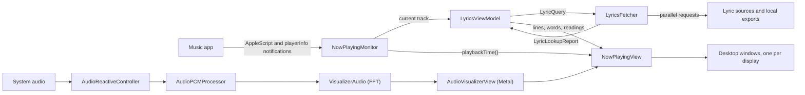

# Architecture

Lunalyr is a single macOS app target written in Swift with SwiftUI and AppKit, plus Metal shaders and a few small, portable C modules. It runs as a menu-bar accessory app: there is no Dock icon except while the workspace window is open, and its main output is one borderless window per display, placed just above the desktop picture and below the desktop icons.

This document maps the source tree and follows the data from the Music app to the pixels on your desktop. For build commands, see the [README](../README.md#build-from-source) and [CONTRIBUTING.md](../CONTRIBUTING.md).

> The Xcode target and Swift module are still called `VersoCustom`, and many types and helpers keep Verso-era names (`VersoApp`, `Verso` palette, `versoDisplayID`, `VC…` C types). The [README explains why](../README.md#build-from-source).

## Overview

## Repository layout

| Path | Contents |
| --- | --- |
| `Sources/` | The app: Swift, Metal and C sources, resources and the asset catalogue. |
| `Tests/Swift/` | XCTest suites, hosted in the app (`VersoCustomTests`). |
| `Tests/*.c` | Portable C test suites for the modules in `Sources/Support/`. |
| `Tests/Python/` | Tests for the update and packaging helpers in `Scripts/`. |
| `Scripts/` | Build, test, packaging, release and performance scripts. |
| `ThirdParty/` | Provenance for adapted third-party code: original files and a `SOURCE.md` manifest per project. |
| `Tools/` | `licensekeygen.swift`, Verso's licence-key tool. The paywall it supports is disabled. |
| `docs/` | Long-form documentation, including the preserved [upstream Verso material](upstream/README.md). |
| `project.yml` | The [XcodeGen](https://github.com/yonaskolb/XcodeGen) spec. The Xcode project is generated from it and not committed. |

## Module map

### App entry

| File | Role |
| --- | --- |
| `VersoApp.swift` | The `@main` SwiftUI app. Shows the `MenuBarExtra` (`MenuBarView`) and starts `NowPlayingMonitor`. |
| `AppDelegate.swift` | Loads the interface font, starts the desktop and control-panel controllers, resumes audio capture if it was on, configures updates, and opens the workspace on first run. |
| `VersoCustom-Bridging-Header.h` | Exposes the C modules in `Support/` to Swift. |

### `Desktop/`: windows on the desktop

| File | Role |
| --- | --- |
| `DesktopWallpaperController.swift` | One click-through window per screen at desktop level + 1, on all Spaces, each hosting `NowPlayingView`. Rebuilt when displays change. |
| `ControlPanelController.swift` | One `NSPanel` per display, above the icons, holding `MediaControlsView`. Only the hovered display's panel accepts clicks. |
| `HoverState.swift` | Polls the pointer and decides which display, if any, shows its controls. |
| `MediaControlsView.swift` | The hover playback controls. |
| `DisplayGeometry.swift` | Screen IDs and frames, and `DesktopVisibility`, which stops hover from triggering through app windows. |
| `WindowRenderActivity.swift` | Tracks each window's occlusion and display sleep. Rendering pauses while displays sleep, and for fully covered windows when **Pause fully covered wallpapers** is on. |

### `NowPlaying/`: playback, artwork and audio capture

| File | Role |
| --- | --- |
| `NowPlayingMonitor.swift` | Reads the current track from Music over AppleScript. Publishes the track, artwork, play state and animated cover, and estimates the playback position between reads. |
| `ArtworkProvider.swift` | Finds artwork through the iTunes Search API when Music does not provide it. |
| `MotionArtworkProvider.swift` | Finds an album's animated cover from its public Apple Music page. |
| `AudioReactiveController.swift` | Owns audio capture for the visualisers: start, stop, fallback, reconnection and the status shown in settings. |
| `SystemAudioCapture.swift` | Core Audio process tap on a private aggregate device (macOS 14.2+). Also defines `AudioCaptureMethod`. |
| `ScreenAudioCapture.swift` | ScreenCaptureKit compatibility capture. |
| `AudioPCMProcessor.swift` | Decodes PCM buffers on a serial queue; feeds the FFT and the level meters. |
| `AudioCaptureRecovery.swift` | Decides when automatic capture should fall back (no, stale or silent packets). |

### `Lyrics/`: finding, timing and reading lyrics

| File | Role |
| --- | --- |
| `LyricsViewModel.swift` | The lyric state for the current track. Starts lookups and applies results, QQ gap repair and readings. |
| `LyricsFetcher.swift` | Runs lookups across sources, ranks and chooses a result. Also contains the LRCLIB client (Lyricsfile YAML via Yams, with an LRC fallback) and the LRC parser. |
| `LyricSources.swift` | `LyricSourceID` (the eight sources), `LyricSourceOptions` (enabled sources, order and selection mode), `LyricQuery`, `LyricCandidate` and `SavedLyrics` (on-disk cache and pinned choices). |
| `KPoeLyricsProvider.swift` | Lyrics+ (KPoe) mirrors; merges syllables into words. |
| `NetEaseLyricsProvider.swift` | NetEase Cloud Music, word-timed YRC with an LRC fallback. |
| `AdditionalLyricsProviders.swift` | QQ Music, Kugou, Kuwo and lyrics.ovh. |
| `LocalLyricBridge.swift`, `LocalLyricsWatcher.swift` | Read-only bridge to a folder of Lyrimuse exports (LRC, `.roma.lrc`, TTML, YRC), and a watcher that triggers a new lookup when it changes. |
| `TTMLLyricParser.swift` | Hardened TTML parser, used for local exports and manual imports. |
| `QQGapRepair.swift` | Optionally treats long pauses in QQ Music lyrics as instrumental gaps. |
| `LyricLineIndex.swift` | Sorted line starts for binary search by playback time. |
| `LyricGapTiming.swift` | Builds the sorted vocal windows used to find instrumental gaps. |
| `LyricRomanization.swift` | `LyricRomanizer`: language detection and romanisation off the main thread. |
| `SongOffsets.swift` | Per-recording timing offsets. |

### `UI/`: what is drawn

| File | Role |
| --- | --- |
| `NowPlayingView.swift` | The desktop scene. One `TimelineView` drives each frame: the background, the lyric layer and interludes. |
| `WallpaperViewport.swift` | Sizes the wallpaper independently of the lyric layer, so long lines cannot move or resize the background. |
| `LyricComposition.swift` | The eight compositions and word entrances, and `LyricLineView`, which routes each composition to its renderer. |
| `ScatteredLyricText.swift`, `SpokenTypographyView.swift` | The two lyric renderers: flowing compositions (Scattered, Constellation, Constellation + Editorial, Echo, Editorial) and word-arrival compositions (Spoken, Cascade, Cutout). |
| `LyricTypography.swift`, `LyricStageFit.swift`, `WordPresentation.swift` | Cached typography, fitting lines to the stage, and per-word reveal state. |
| `InstrumentalInterludeView.swift` | The interlude ribbons and next-vocal cue. |
| `ShaderBackgroundView.swift` + `Shaders.metal` | The 27 ambient GPU effects, run per pixel through SwiftUI's `colorEffect`. |
| `FractalBackgroundView.swift` | The 18 line patterns, drawn on the CPU. |
| `AnimatedGradientView.swift`, `MotionArtworkView.swift`, `CustomWallpaperView.swift` | Album-colour gradients, animated album covers, and imported images or videos. |
| `ColorExtractor.swift`, `TrackMood.swift`, `VersoPalette.swift` | Palettes from artwork, a per-track mood used by automatic choices, and the app's colours. |
| `ConnectionGeometryCache.swift`, `VisualClock.swift`, `AppFont.swift`, `MenuBarView.swift` | Constellation link cache, animation clocks, interface font loading, and the menu-bar panel. |

### `Visualizers/`: audio-reactive scenes

| File | Role |
| --- | --- |
| `AudioVisualizerView.swift` | Wraps a paused `MTKView` drawn once per wallpaper frame. Defines `AudioVisualizerStyle`. |
| `VisualizerShaders.metal` | A full-screen vertex shader and four fragment shaders. Silk Ribbons and Spectral Aurora share `auroraFragment` with different settings. |
| `VisualizerUniforms.swift` | `VizUniforms`, the 168-byte uniform block shared with Metal. |
| `AudioAnalyzer.swift`, `VisualizerAudio.swift` | FFT analysis into 64 logarithmic bands, per channel, merged without phase cancellation. `VisualizerSmoother` smooths the result over time. |
| `RenderScaleLadder.swift` | Adjusts render resolution to keep each frame within its time budget (`GPUFrameTimer`). |

### `Settings/`, `Updates/`, `Licensing/`, `Support/`

| File | Role |
| --- | --- |
| `Settings/Settings.swift` | Wallpaper, typography, performance and audio preferences, plus the global lyric offset, stored in `UserDefaults`. Lyric source, local folder, reading and per-recording offset options have their own stores. |
| `Settings/LunalyrWorkspace.swift` | The workspace window: sidebar, live preview and the seven inspectors (Wallpaper, Typography, Lyrics, Readings, Album covers, Performance, About). |
| `Settings/SettingsWindow.swift`, `SettingsLivePreview.swift` | The window controller, and a preview that renders the real `NowPlayingView` at 1280×720. |
| `Settings/GoogleFontsProvider.swift`, `GoogleFontsCatalog.swift` | Downloads and registers Google Fonts for the running process. |
| `Settings/CustomWallpaperStore.swift`, `PowerSource.swift` | Copies of imported wallpapers; whether the Mac is on battery. |
| `Updates/AppUpdates.swift`, `UpdateConfiguration.swift` | Starts Sparkle only when a valid HTTPS feed and EdDSA public key are configured. |
| `Licensing/LicenseManager.swift` | Verso's offline licence check. `paywallEnabled` is `false`, so every feature is available. |
| `Support/*.c` | Portable C: PCM decoding and level analysis (`AudioAnalysis`), Constellation geometry, vocal gaps and word reveal (`ConstellationGeometry`), hover and display logic (`DesktopInteraction`), and word motion (`LyricMotion`). |

## From the Music app to the desktop

### 1. Now playing

`NowPlayingMonitor` reads Music's state over AppleScript. It re-reads the track when Music posts its `com.apple.Music.playerInfo` distributed notification, and a two-second timer re-reads the play state and position. Between reads, `playbackTime()` extrapolates the position, and every rendered frame calls it.

The monitor publishes `current`, `idleSince`, `artwork`, `isPlaying` and `motionArtwork`. Artwork comes from Music when available, otherwise from `ArtworkProvider`.

### 2. Finding lyrics

`LyricsViewModel` observes the current track and is the only caller of `LyricsFetcher.lookup`. A lookup runs when the track changes, when source options change, when the local exports folder changes, and when you search or reset a choice in the Lyrics inspector.

`LyricsFetcher` checks, in order:

1. a result you pinned to this recording;
2. a cached automatic result;
3. every enabled source in parallel. LRCLIB has a 20-second timeout; the other sources have 8 seconds.

`ranked()` drops candidates whose title, artist or duration do not match. It sorts the rest by timing quality (word, then mixed, then line, then plain text), then by match similarity, then by your source order. `choose()` then keeps only the best timing quality when the mode is **Accuracy first** (the default) or **Prefer real word timing across sources** is on (also the default). Next, a word-timed LRCLIB result wins if **Prefer LRCLIB with real word timing** is on (the default). Otherwise **Accuracy first** takes the top-ranked result and **Source order** takes the first remaining source in your order.

`SavedLyrics` stores results as JSON in `~/Library/Application Support/Verso Custom/Lyrics/`. Automatic results (`cache-*.json`) expire after 14 days, and at most 150 are kept. Pinned choices and imports (`pin-*.json`) never expire. Cache keys include a fingerprint of the source settings, so changing sources looks lyrics up again.

### 3. Timing and readings

`NowPlayingView` adds the global offset (`Settings.lyricOffset`) and the per-recording offset (`SongOffsets`) to `playbackTime()`. It finds the active line with a binary search over `LyricLineIndex`. Per-word reveal and the next-word preview come from `WordPresentation` and the C helpers in `ConstellationGeometry.c`. Karaoke fill and held-note emphasis are computed in `ScatteredLyricText.swift`, and word motion comes from `LyricMotion.c`. `LyricGapTiming` prepares the vocal windows; on each frame `NowPlayingView` finds the current instrumental gap with `vc_vocal_gap` and hands it to `InstrumentalInterludeView`.

`LyricRomanizer` runs off the main thread. When readings are shown **Below lyrics** and **Prefer saved readings** is on (both defaults), it uses readings supplied with the lyrics. Otherwise it generates them with `CFStringTokenizer` and ICU transforms, detecting the language with NaturalLanguage unless you choose one. The results land in `LyricsViewModel.romanized`.

### 4. Drawing a frame

Each desktop window hosts `NowPlayingView`. A single `TimelineView(.animation)` ticks at the chosen frame rate (15, 30 or 60 fps), or at 30 fps while Lunalyr is sparing the GPU (low power visuals, macOS Low Power Mode or battery power, depending on your settings), and pauses through `WindowRenderActivity` when the display sleeps, or when the window is covered and you have turned on pausing for covered wallpapers.

Inside it, `WallpaperViewport` stacks two layers:

- **Background**: nothing (Your wallpaper), an animated album cover, an imported image or video, a GPU effect, a visualiser, or an album-colour gradient on its own (Colour only) or with a line pattern. Changes cross-fade, except when switching to or from Your wallpaper. In **Match the music** mode, an animated cover wins if there is one, then a GPU effect for high-energy tracks, then a pattern.
- **Lyrics**: `LyricLineView` sends Spoken, Cascade and Cutout to `SpokenTypographyView` and the other compositions to `ScatteredLyricText`.

The workspace preview (`SettingsLivePreview`) renders the same `NowPlayingView`, so what you see in settings is what the desktop draws.

## Visualiser pipeline

Visualisers are complete wallpapers: audio shapes their own geometry and light. Audio is captured only while **System audio** is on and a visualiser is the active background.

1. **Capture.** `AudioReactiveController` starts `SystemAudioCapture`, a private, unmuted Core Audio process tap on macOS 14.2 and later. In Automatic mode it falls back to `ScreenAudioCapture` (ScreenCaptureKit) on an error, after a 12-second startup timeout, or when `AudioCaptureRecovery` sees no, stale or silent packets. It reconnects when the output device changes or the Mac wakes.
2. **Decode.** `AudioPCMProcessor` decodes each buffer on its serial queue with `vc_audio_decode_pcm` (`AudioAnalysis.c`). It sends per-channel samples to `VisualizerAudio` and level meters to the settings UI.
3. **Analyse.** `VisualizerAudio` runs one `AudioAnalyzer` per channel: a vDSP FFT into 64 log-spaced bands with bass, mid and treble summaries. Channels are merged by taking the maximum per band, so opposite-phase stereo cannot cancel out.
4. **Smooth.** On each frame, `VisualizerSmoother` follows the latest snapshot with attack and release envelopes, then blurs neighbouring bands slightly so adjacent FFT bins do not make sharp corners in the geometry.
5. **Render.** `AudioVisualizerView` fills `VizUniforms` and draws a full-screen triangle with the style's fragment shader from `VisualizerShaders.metal`. The drawable is capped at about 1.8 megapixels (0.95 for Spectrum Tunnel), and `RenderScaleLadder` lowers the scale between 0.5 and 1.0 when `GPUFrameTimer` reports frames over budget.

The five visualisers are Silk Ribbons, Spectral Aurora and Spectrum Tunnel (adapted from [Synesthia](https://github.com/jonjaques/synesthia)), Aurora Curtains (built on Verso's ambient Aurora material) and Fosfora Aurora (ported from [Fosfora](https://github.com/kevinraymond/fosfora)). The `ThirdParty/` manifests record what was adapted and how.

The 27 ambient GPU effects are separate: they are `[[stitchable]]` functions in `Shaders.metal`, applied through SwiftUI's `colorEffect`, and they do not react to audio.

## Settings and storage

`Settings` and the option stores (`LyricSourceOptions`, `LocalLyricOptions`, `RomanizationOptions`, `SongOffsets`) use `UserDefaults.standard`, so everything lives in the `local.verso.custom` defaults domain. Keys inherited from Verso have no prefix (for example `backgroundMode`); keys added by Lunalyr start with `custom.` (for example `custom.animationRate`), apart from `constellationLinkOpacity`. Keep existing keys when changing a setting's meaning, or add a migration, so updates do not reset preferences.

The app is not sandboxed. On disk it uses:

| Path | Contents |
| --- | --- |
| `~/Library/Application Support/Verso Custom/Lyrics/` | Cached and pinned lyrics (`SavedLyrics`). |
| `~/Library/Application Support/Verso/Fonts/` | Downloaded Google Fonts, including the interface face, Manrope. |
| `~/Library/Application Support/Lunalyr/Wallpapers/` | Copies of imported images and videos. |

Artwork, animated covers and AppleScript results are cached in memory only. The Lyrimuse folder you choose is only ever read.

## Updates

`UpdateConfiguration` enables the updater only when `Info.plist` has an HTTPS `SUFeedURL` and a valid 32-byte `SUPublicEDKey`. `AppUpdates` then starts Sparkle's standard updater. Automatic checks, automatic installation and system-profile reporting are off. The feed is the `appcast.xml` attached to the latest stable GitHub release. See [RELEASING.md](RELEASING.md).

## Build and test

`project.yml` defines one app target and one test target, both still named after Verso:

- **`VersoCustom`** builds `Lunalyr.app` (bundle ID `local.verso.custom`, deployment target macOS 14.0) with the Swift packages [Yams](https://github.com/jpsim/Yams) 6.2.2 and [Sparkle](https://github.com/sparkle-project/Sparkle) 2.10.0.
- **`VersoCustomTests`** is the XCTest bundle, hosted in the app. It includes real Metal rendering tests, so it needs a Mac with a GPU.

| Command | What it does |
| --- | --- |
| `bash Scripts/test.sh` | Generates the project and runs the XCTest suite in Debug. Log: `Build/test.log`. |
| `bash Scripts/build.sh` | Builds and runs the four C suites with `-Wall -Wextra -Werror`, builds Release, checks the Metal library and Sparkle framework, and copies the app to `Build/Lunalyr.app`. Log: `Build/build.log`. |
| `python3 -m unittest discover -s Tests/Python` | Tests the update configuration and packaging helpers. |

| C module | Test suite |
| --- | --- |
| `Support/AudioAnalysis.c` | `Tests/audio_test.c` |
| `Support/ConstellationGeometry.c` | `Tests/geometry_test.c` |
| `Support/DesktopInteraction.c` | `Tests/desktop_test.c` |
| `Support/LyricMotion.c` | `Tests/motion_test.c` |

GitHub Actions runs the same steps. **Build Lunalyr for Mac** (`.github/workflows/macos.yml`) runs on pull requests and on pushes to `main` that change more than documentation. It runs the Python tests, the XCTest suite and the Release build, then uploads the app and logs. Started by hand, it can also prepare a signed draft release. **Publish preview release** (`.github/workflows/release.yml`) is started by hand and publishes a GitHub pre-release.
