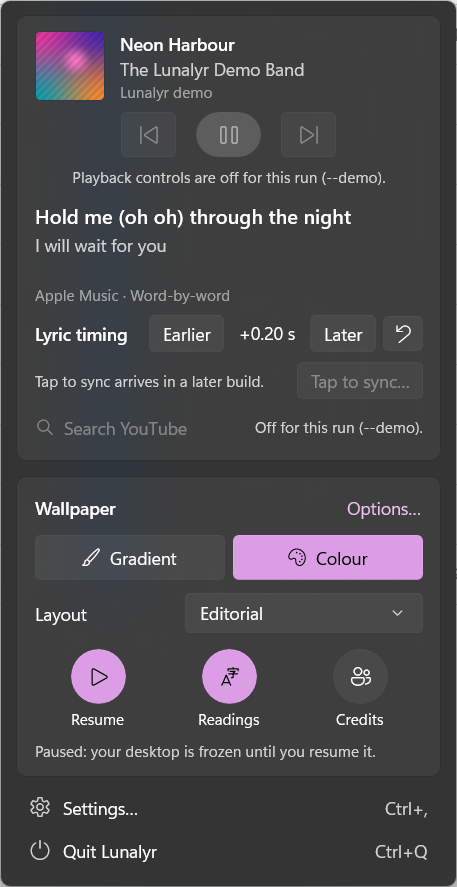

# Milestone 5: desktop player, tray flyout and settings

## Tray flyout

Branch `m5/tray-flyout` (from `next/windows` ee715c9). The tray icon's left click now opens a Fluent flyout, the
Windows counterpart of the Mac's menu-bar panel; the right-click menu stays (the song, Open settings, Pause/Resume
wallpaper, Quit Lunalyr). Details: [APP-SHELL.md, "Tray flyout"](../APP-SHELL.md#tray-flyout).

| Dark | Light |
| --- | --- |
|  |  |
|  |  |

The previews are the AOT build with `--demo --theme dark|light`, captured from the screen. The second row shows the same
panel after "Earlier" ×3 and "Later" ×1 (+0.20 s for this song), Pause, Credits off and the Colour tile.

### What works

- **Window:** Acrylic, rounded corners, light/dark (Windows' or `--theme`), accent colour, no title bar, always on
  top, not in Alt+Tab. It sits beside the taskbar on any edge, at any scale, inside the work area. A click elsewhere,
  Esc, Alt+F4 or another click on the icon closes it.
- **Content, in the Mac's order and wording:** the song (cover, title, artist, player); the transport where the player
  takes it, with a calm line where it doesn't; the line being sung with its source; this song's lyric timing (Earlier,
  Later, reset); Tap to Sync shown disabled; Search YouTube; the wallpaper's quick controls; Settings… and Quit.
- **Keyboard and Narrator:** every control can be reached with Tab in reading order and has a Narrator name. Esc closes
  the panel, Ctrl+, opens settings and Ctrl+Q quits.
- **Never a sound in checks:** the transport and Search YouTube are off with `--no-playback` and `--demo`. Every
  transport press asks `PlaybackGuard` first, and Search YouTube opens only through an `IUrlLauncher` (a recording fake
  in the tests).

### Verified on this PC

AOT publish, `--demo --data <temp> --seconds 120`, opened with the tray window's own message (`NIN_SELECT`):
- Placement was right above the icon, at 125%.
- Light and dark screenshots were checked by eye.
- UI Automation read every control's name and state.
- The Tab order follows the screen, and Esc closes the panel.
- A change of focus away from the panel closes it. The Layout drop-down doesn't close it.
- Earlier and Later saved +0.20 s under the song's key. Pause stopped the wallpaper, and Credits, Colour and the
  layout went to `settings.json` and the renderer.
- The transport and Search YouTube were never pressed. Both stay off under `--demo`.
- The WER and Application logs had no Lunalyr events after the fix below.

### Found and fixed on the way: WinUI started late crashed

Opening any window once start-up had run made `Application.Start` fail with `0x8007029C`. That covers a tray click and
a second launch asking for settings, and it happened in most runs. A retry then ended in a fail-fast. It wasn't new:
Test Build 4.1 crashed 6 of 6 times and Test Build 3 5 of 6 on a second launch with `--settings`.

Probes narrowed it to the cover decoding (WIC) the controller runs on each track change:
- With that decoding off, WinUI started 6 of 6 times.
- With start-up stopped just before the controller starts, it started 20 of 20 times.
- Sharing one WIC factory didn't help.

WinUI now starts right after the tray icon, as `--settings` always did, and start-up begins inside its first callback.
It started 10 of 10 times from the tray and 4 of 4 from a second launch. The cost is about +30 MB working set at idle
with the wallpaper running: 187 MB against 157 MB. The settings and player work rely on the same path.

### Tests

`tests/Lunalyr.Shell.Tests`: `TrayFlyoutTests`, `TrayFlyoutCommandTests`, `FlyoutPlacementTests` and
`AppControllerFlyoutTests`, 46 tests (the suite is now 1,679: 1,678 pass, 1 skipped as before, run twice). Seven are ported from the Mac with the same inputs:
- `testTimingNudgeWordsTheOffsetBothWays`
- `testNudgingSavesTheOffsetForThePlayingSongInTheModelsGiven` (without its announcement count)
- `testSyncNudgeIsSavedForThePlayingRecordingInTenthSteps`
- `testPlayPauseShowsThePressAtOnce`
- `testARepeatedLineIsStillANewLine`
- `testHiddenLyricsAreNeverQuotedInThePanel` (its source, content and spoken parts)
- `testThePanelNamesItsActionsForWhatTheyActOn` (its transport, pause and prompt parts)

### Left to do / differences from the Mac

- **The Mac's controls with no Windows setting yet:**
  - Hide lyrics (`lyricsVisible`, with the mirroring banner).
  - Floating lyrics (milestone 7).
  - Lyric card (milestone 7).
  - The visualiser's Scene picker (milestone 6).
  - The other wallpaper types (Match, Visualiser, Effects, Patterns, Your wallpaper, Image or video, Music video).
  - The Player picker (`PlayerOptions.choice`).
  - Check for Updates… (milestone 8).
  - The status banners: automation, system audio, mirroring, power saving.
  - The paused badge on the menu-bar icon.
- **Tap to Sync:** the estimator is ported (`LyricTapSync`) but there is no window to tap in. No milestone names it, so
  the row says "in a later build".
- **Search YouTube** opens the browser's results. The Mac's opens its own picker for the music-video wallpaper
  (milestone 6).
- **Needs a live check with real music:**
  - The transport against a real player: the buttons were tested only against the silent fake and the demo.
  - A real left click, which gives the panel the foreground so a click outside closes it. Posted messages don't.
  - Mixed-DPI monitors.
  - Auto-hide and side taskbars on screen.
