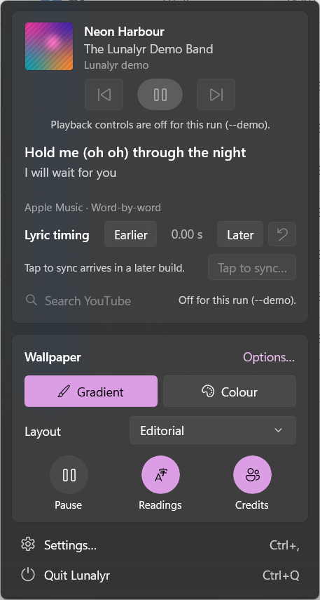
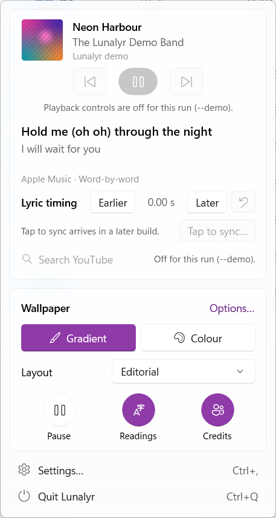
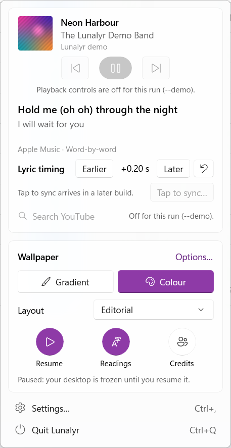

# Milestone 5: desktop player, tray flyout and settings

## Settings window

Branch `m5/settings-window` (from `next/windows` ee715c9). The Fluent settings window with the Mac's pages; every
setting the Windows app supports is set from it and applies at once, without a restart. How it is built is in
[APP-SHELL.md](../APP-SHELL.md) ("Settings window"); screenshots of every page in light and dark are in
[`docs/previews/settings/`](../previews/settings/).

### Pages

Live means the control changes the setting and the wallpaper follows at once. Disabled rows show the milestone that
brings them ("a later build" where the port's plan doesn't say).

| Page | Live | Disabled, and why |
| --- | --- | --- |
| **Lyric style** | Live preview; Layout (Match the music and all 14); Change layout every song; Layouts in the rotation (0–5 songs in a row each); Show the song title at the start, Show the album cover; Show credits in the background; Lyric size; Typeface (Segoe UI Variable or an installed family, listed from DirectWrite); Highlight colour (complement, album, custom with Windows' colour picker); Entrance (per layout, or Match the music's own for every layout it picks; entrances a stage layout leaves out are marked "whole lines only" with the Mac's note); Custom mix (11 check boxes); Constellation: Spread, Links; Echo: Repeats; Show three dots during instrumental breaks | Floating lyrics (milestone 7). Backing vocals in the background (always on; a later build). Add Editorial typography, Randomise lyric fonts, lyric Colour mode (Album drift is what Windows draws), Reveal sung words, Faint next-word preview, Remember a style (a later build). |
| **Wallpaper** | Type: Album colours (`gradient`) or Colour only (`colourOnly`) | Visualisers and Music video (milestone 6). Match the music, GPU effects, Line patterns, Your wallpaper, Imported image or video; Automatic text backing (always on); Motion speed, Colour richness, Darkening (the renderer has them, but they aren't settings yet) (a later build). |
| **Covers** | — | Animated covers, Placement, Softening (a later build). Points to the opening title's cover under Lyric style. |
| **Timing** | This song: the song and its lyric source, Song offset (±10 s, widening to ±30 s) with Reset; Choose by (Accuracy first, Source order) with the Mac's ranking text; Restore Recommended Order; Sources in priority order (on/off, raise, lower; focus stays on the moved source); Search under other names; Lyrimuse lyrics folder (Choose…, Clear; choosing switches the local source on); Global offset (±3 s, "Later"/"Earlier"); Treat long pauses as instrumental (its caption follows the three dots); since "Lyric tools" below: Tap to sync with Undo, a saved choice with Return to Automatic, Find lyrics (Search, Use Playing Song, the matches with Use for This Song, Close matches not used), Import LRC or TTML, When none are found | The Mac's "Use Default Lyrimuse Folder" is left out: Lyrimuse is a Mac app with no Windows folder. |
| **Readings** | Display (Off, Under the lyrics, Instead of the lyrics); Language (worded afresh; see "Provenance"); Keep tone marks; Prefer saved readings | Import reading LRC, Show translations under lyrics (a later build). |
| **Music players** | Following: the player and song now (read-only) | Choosing one player (a later build). Windows follows every app that shares what it plays with Windows; there is no per-browser switch to make. |
| **General** | App theme (follow Windows, light, dark: Lunalyr's windows only) | Launch at login, Check for Updates (milestone 8; nothing is written to the registry). Show welcome again (a later build). Lyric in the tray, Keyboard shortcuts, Discord status, Lyric cards (milestone 7). |
| **Performance** | Frame rate (15, 30, 60 fps, Match the display); Pause while energy saver is on; Pause fully covered wallpapers | Pause behind full-screen apps and games: shown on and fixed, because the renderer always pauses there (by design; the `pauseWhenFullScreen` key has no consumer). Low power visuals (patterns aren't ported), Show player on hover (a later build). |
| **About** | Version, "Desktop lyrics, in motion.", privacy, licence and third-party notices, live diagnostics | — |

### Settings and the scene contract

- New keys (Mac names and defaults): `constellationSpread` 1.0 (0.4–1.8), `constellationLinkOpacity` 0.2 (0–0.6),
  `echoStrength` 1.0 (0–1.8), `wordEntranceMix` (Soft focus, Float up, Cutout · Fold), `wordArrivalByStyle` ({}), and
  the Windows-only `appTheme` ("system"). All repaired on load like the others.
- `LyricStyle` gained `ConstellationSpread`, `ConstellationLinkOpacity`, `EchoStrength`, `MixEntrances`,
  `RevealByLayout`, `RevealFor(id)` and `EntranceFor(kind)`, additively, with value-equal `ValueList`/`ValueMap`. The
  composition layers read Spread (the constellations' line setting), Links (hairline opacity, none at 0) and Repeats
  (Echo's repeat opacity, none at 0) from the style instead of the defaults; the defaults are unchanged, so earlier
  renders don't move.
- `wordArrival` stays as the entrance for layouts without their own. With Match the music, an entrance saved under
  `"automatic"` is used for every layout it picks; otherwise each layout's own entry. This lookup is re-implemented
  from the behaviour of the Mac's `Settings.arrival(in:)`, whose lines trace back to the squashed Verso import.
- `AppController.SongOffset` / `SetSongOffset` (new partial file) read and set this song's offset for the source
  showing; the clock reads it every frame.
- `--settings-page <page>` and `--theme <light|dark|system>` (both forwarded by a second launch) open a page and set the
  look for one run, for checks and screenshots.

### Checked on this PC

- AOT publish (`dotnet publish src/Lunalyr.App/Lunalyr.App.csproj -c Release -p:Platform=x64`), clean.
- `Lunalyr.exe --demo --data %TEMP%\lw2-settings-check --settings --seconds …`, each page opened by a second launch
  with `--settings-page` and `--theme`, captured with `tools/capture-window.ps1` in light and dark.
- Settings changed through UI Automation (no synthetic input) and followed in the app's log and `settings.json`:
  Layout → Echo ("Layers: background "gradient", lyrics "echo""), Repeats 1.8 → 0 (the preview showed the repeats go),
  Wallpaper → Colour only ("Layers: background "colour""), Frame rate → 30 fps, Pause fully covered wallpapers off (the
  covered surfaces started drawing), Global offset 0.5 s, Song offset 1.25 s (saved under the song's hashed key),
  LRCLIB off (the song looked up again), QQ Music raised, Readings → Instead of the lyrics.
- App theme without `--theme`: set to Dark from General, the window turned dark and stayed dark on the next page. Closing the window (UIA `WindowPattern.Close`) left the tray and wallpaper running; a second launch opened it again; `--seconds` then ended the run with "Stopped cleanly" and exit code 0.
- Driven once each in the AOT build, with the log and crash files checked: the colour picker flyout (hex box set to 3366FF, saved as `#3366FF` when it closed), a rotation number box (Echo → 3), the Font family list (populated from DirectWrite; Impact chosen, saved), a Custom mix check box (Pop), Reset song offset, Restore Recommended Order, and the folder picker (opened, then closed: "No folder chosen."). Choosing a folder inside Windows' dialog wasn't automated; the setting it writes is covered by `SettingsCopyTests`.
- Narrator names: a UI Automation walk of every page found no unnamed interactive control (105 on Lyric style with its
  options open, 56 on Timing).
- No crash files, no WER reports and no Application-log errors for this build after each launch.
- High contrast wasn't switched on (that's a Windows setting): colours come only from theme resources in styles.

### Provenance

The Mac's settings pages, `EntranceSupport.swift`, `SettingsLivePreview.swift`, `FormComponents.swift`, `SettingsStyle.swift`,
`DesignTokens.swift`, `QuickControls.swift`, `LyricHighlightColour.swift`, `DesktopOptions.swift` and `LunalyrWorkspace.swift` were
blamed against `a99fd65`: their only Verso-attributed lines are imports and boilerplate (`var id`, `@Environment(.accessibilityReduceMotion)`).
Re-implemented from behaviour: the per-layout entrance lookup (`Settings.arrival(in:)`); the keys and defaults of
`constellationSpread`, `constellationLinkOpacity`, `echoStrength` and `wordArrivalByStyle` are on Verso lines in
`Settings.swift` and are taken as data only. The readings menus are worded afresh ("Under the lyrics", "Detect
automatically", "Japanese (rōmaji)"…) because their Mac titles are on Verso lines in `LyricRomanization.swift`. The
wallpaper type titles "Match the music", "GPU effects", "Line patterns" and "Colour only" sit on Verso lines in
`Settings.swift` but are also Lunalyr's own words on its Wallpaper and Performance pages, which is where they are taken
from. The Mac About page's "Built on open source" card (Verso and visualiser credits) is not ported. The source titles come
from Windows' existing `LyricSourceInfo`.

### Tests

New: `SettingsWindowSettingsTests` (defaults, repair, file round trip, per-layout and Match the music entrances, the
mix, value-equal styles), `SettingsCopyTests`, `EntranceSupportTests`, `SettingsWindowOptionsTests`,
`SettingsPreviewRendererTests` (WARP), `AppControllerSettingsWindowTests` (sliders, mix and entrance reach the scene
without a new lookup; this song's offset), `FamilySettingsRenderTests` (Repeats 0 and Links 0 draw none, Spread moves
the words, per-layout entrance and mix reach the plan). The documented-keys test lists the new keys.

Ported from the Mac (same inputs and outputs): `SettingsFollowupTests` — `testStageLayoutsThatIgnoreEveryChosenMotion`,
`testOtherLayoutsShowEveryEntrance`, `testTheMenuMarksAndExplainsALeftOutEntrance`, `testTorqueAndFableMatchTheRenderer`
(its rule; the Mac's `StageLyricView.chosenEntrance` half has no Windows counterpart);
`SettingsPolishTests.testTheSongOffsetSliderWidensForLargeOffsets`; `DesignSystemTests.testTimingNudgeWordsTheOffsetBothWays`.

Not ported: `testALeftOutEntranceDoesNotLockReveal`, `testRevealLockMatchesWhatTheRendererRequires` (Windows has no
"Reveal sung words" setting yet); the slider-drag, page-memory, undo/redo, sidebar-arrow, swatch and welcome tests in
`SettingsPolishTests` (SwiftUI controls and Mac features the WinUI controls or a later milestone cover);
`SettingsWindowTests` (the Mac's window frame, preview column and SF Symbols); `SettingsFollowupTests`' Discord,
sharing and shortcut captions (milestone 7); `TypographySettingsTests`' Editorial and Google Fonts tests (not ported).

### Left

- The rows marked for a later build. The wallpaper adjustments need the background factories rebuilt on change.
- The preview costs memory: 373 MB working set with it showing against 258 MB on General (a second Direct3D device and the layers' text). Leaving Lyric style releases its device, but the working set had only fallen to 353 MB 4 s later; it may need a closer look.
- The folder picker is the Windows App SDK's (`Microsoft.Windows.Storage.Pickers`): the older `Windows.Storage.Pickers.FolderPicker` never opened its dialog in this unpackaged AOT app.
- Nothing here was tried with Narrator itself or in high contrast.

## Spotify search and queue

Branch `m5/spotify` (from `next/windows` ee715c9). The service layer for the desktop player's search, play and queue
on Windows, with no UI: the player card and the settings page call it after the merge. Setup, behaviour and the API
the card calls are in [APP-SHELL.md](../APP-SHELL.md#spotify-search-and-queue).

**Owner's decision:** search, play and the queue go through Spotify's Web API, opted into with the owner's own
Spotify sign-in and their own developer app. The client ID is pasted into the settings (`spotifyClientId`); no client
ID or secret ships.

### What was built

| Mac (`next/integration` 79b84db) | Windows | Notes |
| --- | --- | --- |
| `PlayerSearchResult`, `PlayerQueueItem`, `PlayerQueueSnapshot` | `Core/Player/PlayerSearchModels.cs` | The Mac's three targets (library track, `music://` address, Spotify search page) become one `PlayerSearchTarget`: a Spotify URI plus the song's album. The queue item and snapshot gain the album, the cover and the context. |
| `QueueOutcome`, `QueueSolo` and their notes | `PlayOutcome`, `QueueSolo` | Notes word for word. New: `QueueSolo.LastOnAlbum` and `PlayOutcomeKind.Unchanged` (the song playing was clicked). |
| `PlayerSearchError`, `DesktopPlayerModel.words(for:)`, `emptyQueueMessage` | `PlayerSearchError`, `PlayerSearchException`, `PlayerSearchText` | The AppleScript cases (`notRunning`, `blocked`, `scriptFailed`) are gone. The Web API's cases are new: not set up, not signed in, sign-in ended, no Premium, no active device, rate limited, offline, not on the app's user list, playback off. |
| `PlayerSearching` | `IPlayerSearch` | `SearchAsync`, `PlayAsync` and `PlayQueueItemAsync` (returning the outcome, the Mac's `…Noting`), plus `GetQueueAsync`. |
| `NoSearch` | `NoPlayerSearch` | Every player but the Spotify app. |
| `PlayerKind.searcher` | `PlayerSearches.For` / `Availability` / `IsSpotify` | Chooses by the GSMTC session's `MediaSourceApp`. |
| `SpotifySearch` (AppleScript and `spotify:search:`) | `Core/Player/Spotify/`: `SpotifyPlayerSearch`, `SpotifyAccount`, `SpotifyPkce`, `LoopbackRedirectListener`, `SpotifyApiClient`, `SpotifyParsing`, `SpotifyJson` (source-generated), `ProtectedFileTokenStore` | New: Web API, PKCE, loopback redirect, refresh, errors. |
| — | `Platform.Windows/Spotify/`: `DpapiTokenProtector`, `SystemBrowserLauncher` | DPAPI through P/Invoke (no new package). The launcher opens only Spotify's authorize page. |
| — | `LyricHttpClient.SendAsync` | An additive POST/PUT path with headers and a body. `GetAsync` is unchanged. |
| — | `AppSettings.SpotifyClientId`, `AppHost.PlayerSearch`, `AppHost.Spotify` | Additive. `AppController` is untouched. |

Provenance: none of the Mac files read have lines from `a99fd65` (`git blame -w -M -C`): `PlayerSearch.swift`,
`DesktopPlayerModel.swift`, `DesktopPlayerSearchTests.swift`, `SpotifyPlayerTests.swift`,
`PlayerTextAndQueueSafetyTests.swift`, `QueueBuildStepsTests.swift`, `QueueContinuationTests.swift`,
`MorePlayersTests.swift` and `DesktopScrubberTests.swift`. Nothing was re-implemented from behaviour on Verso's account.

### Rules carried over to the Web API

- Search needs two characters or more (`trimmed.count >= 2`, counted as characters on screen). Songs come before
  albums, 8 and 4 at most, as the Mac's catalogue search asks.
- A song carries on with what follows it where the player allows, else it plays alone and says why:
  - A song from search plays on through its album (`context_uri` + `offset`): "Then the rest of its album."
  - A song with no album, or a single, plays alone: "Plays this song only."
  - The last song of a one-disc album plays alone: "…it's the last song on its album."
- The Mac's rescue: when the album form is refused for a reason that may be the request's, the song plays alone:
  "Couldn't line up what comes next…".
- A queue click plays the song and the ones after it. The Mac copies them into its own playlist; here they are sent
  as a `uris` list, up to 50. Songs that can't be started (local files) are left out with the Mac's "Some songs
  after it couldn't be added…". If the list is refused for a reason that may be the request's, the clicked song plays
  alone (the rescue again).
- A queue item with no id can't be clicked (`IsPlayable`).
- Only the latest of quick clicks plays (the Mac's `ClickCounter` and `SerialFlow`).
- Every play is a playback command: it goes through `PlaybackGuard`. Under `--no-playback` or `--demo` nothing is
  sent, not even a token refresh. The service isn't built at all under `--demo` or `--no-network`.

### Mac behaviour that doesn't apply on Windows

- **Apple Music:** library search, library tracks as results (`inLibrary`), playing by persistent ID, library
  artwork, Apple's catalogue search (`itunes.apple.com/search`) and `music://` addresses. Apple Music for Windows has
  no scripting interface, so it gets `NoPlayerSearch` like every other player.
- **The Lunalyr Queue:** the playlist Lunalyr builds in Music to carry on from a song: `QueuePlaylistStore`, the
  prepare, collect, fill, finish and rescue scripts, chunking, pending IDs, deleting only its own playlists, and
  restoring shuffle. On Spotify nothing is created in the account; a URI list or a context plays instead. Its notes
  that depend on the Music library (`source`, `notInLibrary`, `album`) are kept as models but never produced here.
- **AppleScript plumbing:** `ScriptDesk`/`ScriptLane`, which put a play ahead of a search and covers last on one
  script lane. HTTP has no single lane, but the latest-click rule stays. `ScriptText` quoting, the Automation
  permission (`blocked`), `notRunning`, and AppleScript error numbers.
- **The Mac's Spotify search:** "Search Spotify for '…'" opening `spotify:search:` in the app, and `play track` by
  AppleScript. The Web API replaces both, and the Windows app never opens a Spotify page except the sign-in.
- **Web players:** `WebPlayerSearch`, which opens a service's search page in the browser. Browser sessions get no
  search on Windows; Spotify's web player can't be told apart from any other tab.
- **The queue window around the song:** the Mac reads up to 24 songs before and after it in Music's playlist.
  Spotify shares no history and only about 20 songs ahead.
- **Card-level rules** (`DesktopPlayerModel`): `playlistChanged`, `optimisticNext` (Music only; nil for Spotify on the
  Mac), `belongsInHistory` (Music only), the hover/pin display rules and the note toast's timing. These are the player
  card's to port, so they aren't duplicated here.
- **Following Spotify** (`SpotifyBackend`'s AppleScript reads and notifications, adverts): now playing comes from
  GSMTC on Windows, which is outside this work.

### Tests

New tests: 92 cases (75 in `Lunalyr.Core.Tests/Player`, 11 in `Lunalyr.Platform.Windows.Tests/Spotify`, 6 in
`Lunalyr.Shell.Tests/SpotifySettingsTests`). Fixtures are hand-built from Spotify's published reference, in
`tests/Lunalyr.Core.Tests/Fixtures/Spotify`; nothing was fetched from Spotify. The loopback listener is tested with a
local fake browser on a port Windows chooses (never 47823, so parallel runs don't collide). The tests cover:

- the token exchange (through the listener)
- refresh before expiry, single-flight refresh, and a rotated refresh token being kept
- `invalid_grant` signing out, while being offline or a 503 during a refresh keeps the sign-in
- a 401 followed by one refresh and one retry, never a third
- a 403 for no Premium, and a 403 on a read (not on the user list)
- a 404 for no active device, including a bare 404 after the rescue
- a 429 with Retry-After and the quiet period after it, and a 429 without the header
- offline
- search and queue parsing (episodes, local files, unplayable songs, covers)
- playing an album, a song in its album, a song alone, the rescue, and a queue line-up and its rescue
- a sign-in that can't be saved
- the guard, including a block that arrives mid-play
- quick clicks
- the busy port, timeout, cancel and decline
- DPAPI round trip and tampering, the store's unreadable files, and the launcher's address rule
- the settings key

Mac tests ported with the Mac's inputs:
- `DesktopPlayerSearchTests.testSongsWithoutALibraryIDCannotBeClicked`
- `QueueContinuationTests.testEveryWayOfPlayingAloneSaysWhyInPlainWords`, without `PlayerNoteToast` (the card's)
- `MorePlayersTests.testTheDesktopPlayersSwitchShowsWhatIsThere`, its three wording asserts; the switch is the card's

Adapted to the Web API (same rule, new inputs):
- `testOnlyTheLatestOfQuickClicksPlays`
- `testFailuresKeepTheirAppleScriptErrorNumber` (HTTP statuses instead)
- `testAFailedBuildStillPlaysTheSongAndDeletesItsHalfBuiltPlaylist` (the rescue)

Not ported, because they test AppleScript, Music, the Lunalyr Queue or the card:
- `DesktopPlayerSearchTests`: 5 of its 6 tests
- `DesktopPlayerQueueScriptTests`: 7
- `ScriptDeskTests`: 3
- `ScriptTextRoundTripTests`: 2
- `QueueOrphanTests`: 2
- `PlayerDisplayAndHistoryTests`: 2 (the card's)
- `QueueBuildStepsTests`: 5
- `QueueContinuationTests`: 11 of 15
- `SpotifyPlayerTests`: 13, with its split-queue rerun (AppleScript backend)
- `DesktopScrubberTests.testOptimisticNext…` and `testPlaylistChange` (the card's)

### Open questions

- **Not verified live.** The rules forbid signing in or playing anything. These are inferred from the reference, not
  seen:
  - Spotify's real answer to an album `offset` it can't find. The rescue covers a 400 or a non-device 404.
  - Whether a no-device 404 always carries `NO_ACTIVE_DEVICE`. A bare 404 still reads as no device after the rescue.
  - Whether `uris` accepts episodes mixed with songs (the reference says "track URIs"). If it doesn't, a queue click
    plays the clicked song alone.
  - Search sends no `market`. The reference says a user token's country takes priority, so `is_playable` may be
    absent, and only an explicit `false` is left out.
- **Port 47823** is fixed, as the owner asked. If another app holds it, the sign-in says so. Spotify does allow a
  dynamic port for loopback literals, if that's ever wanted.
- **Device choice.** Plays go to Spotify's *active* device, which may not be this PC. If no device is active, the user
  is asked to start Spotify playing. Picking this PC's device from `/me/player/devices` would need device-name
  matching, so it's left for the owner to decide.
- **Settings page.** It needs a client ID field, Sign in / Sign out, the state, and the setup steps from APP-SHELL.md.

## Desktop player

Branch `m5/desktop-player` (from `next/windows` ee715c9), ported from the Mac's next/integration 79b84db, including
5211933 and 79b84db: the card is centred and stays centred when it grows. Design and behaviour are described in
[APP-SHELL.md, "Desktop player"](../APP-SHELL.md#desktop-player).

### What works

- **The "Sleeve" card**, drawn with Direct2D in a DirectComposition window. Why not WinUI is in APP-SHELL.md. It has:
  - the album-washed card, the big cover with its record peeking out (it slides in on pause), the player's name, the
    title and artist, and a round play button between previous and next;
  - light and dark mode;
  - DWM's rounded corners and a 1 px border in the album's colour (no shadow), just above the desktop and under every app.
- **Reveal on the empty desktop:**
  - a polled pointer with the Mac's hover intent (slow down or dwell; a fly-through never reveals) and its dismiss
    guards;
  - one display at a time, a 0.7 s linger, gone at once over a window;
  - no new reveal over a full-screen app or a presentation;
  - centred in the work area of the display under the pointer.
- **The seek bar:**
  - line ticks, section gaps, repeated lines;
  - time and lyric capsules (with readings below or instead);
  - snapping to line starts (Ctrl off), fine scrub by distance or Alt, the rubber band, the pre-roll, Esc to cancel;
  - one seek on release, and the time-left/length toggle (saved as `desktopPlayerTimeMode`).
- **The wallpaper follows a drag** through a preview clock (`AppController.SetScrubPreview` /
  `ReadRendererClock`), held still and shown on every display. The wallpaper lyrics fade to 15 % while the card is up
  and to 80 % while dragging (`RenderEngine.SetLyricFocus`).
- **Commands only through `PlayerCommands`:** the playback guard first, then the player's capabilities, then GSMTC.
  With `--demo` and `--no-playback` they are refused before the session is looked at. The card then says "Controls
  are off for this run; scrubbing only previews.", the glyph and the bar go straight back, and the transport is drawn
  at 60 %. The scrub preview still works.
- **The Mac's key map in Windows terms** (⌘ → Ctrl, ⌥ → Alt, Control → the Windows key), plus Tab focus with a
  focus ring. The table is in APP-SHELL.md.
- **Windows' accessibility settings:** Animation effects off, Transparency effects off, contrast themes (system colours
  only), and Narrator through a UI Automation provider (source-generated COM, AOT safe).
- **Settings (additive):** `showControlsOnHover` (Mac `custom.showControlsOnHover`) and `desktopPlayerTimeMode` (Mac
  `custom.desktopPlayer.timeMode`). The settings window can show them later.
- **`--player-debug`** (`show`, `light`, `dark`, `reduce-motion`, `opaque`, `contrast`, `scrub=x`), for checks that
  can't move the pointer or change Windows' settings.

### Ported (Mac → Windows)

| Mac | Windows |
|---|---|
| `ScrubMath.swift` (`ScrubLine`, `ScrubLyric`, `ScrubMath`, `CoverLookup.normal`) | `Core/Player/ScrubMath.cs` |
| `ScrubSession.swift` | `Core/Player/ScrubSession.cs` (events as flags) |
| `ScrubController.swift` (`ScrubController`, `ScrubPreview`, `OptimisticToggle`, `PlayerHoverFocus.look`) | `Core/Player/ScrubController.cs`, `PlayerCard.cs` |
| `HoverIntent.swift`, and `HoverState.swift`'s Lunalyr-written `shouldPoll`, `pollInterval`, `decide`, `showsPlayer` | `Core/Player/HoverIntent.cs` (`HoverIntent`, `PlayerDismissGuard`, `PlayerInteraction`, `HoverPolicy`) |
| `PlayerKeyMap.swift`, `PlayerKeyboard.swift` | `Core/Player/PlayerKeyMap.cs`, `App/Player/DesktopPlayer.Input.cs` |
| `DesktopPlayerView.swift` (geometry, `PlayerMotion`), `DesktopScrubber.swift` (`ScrubRowKind`, the bar), `SleeveParts.swift` (card, record, note), `PlayerControls.swift` (transport) | `Core/Player/PlayerCard.cs`, `App/Player/CardPainter.cs`, `CardTheme.cs`, `CardLayout` |
| `ArtworkPalette.swift` | already ported in M4 (`Core/Colour/ArtworkPalette.cs`); fed from the controller's decoded cover |
| Hover step (`vc_hover_step` in `DesktopInteraction.c`) | **re-implemented from behaviour** as `Core/Player/DesktopHoverSession.cs`, with its own tests: the C file and `HoverState.swift` still carry lines from the Verso import (a99fd65) |

Provenance check (`git blame -w -M -C` against a99fd65): every `Sources/Player/` file is clean except one line in
`DesktopPlayerView.swift` (`@ObservedObject private var hover = HoverState.shared`, a SwiftUI property with no
counterpart here). `HoverState.swift` has 45 Verso lines, `DesktopInteraction.c` 42 and `desktop_test.c` 67. None
were translated.

### Tests

- **50 of the Mac's tests ported**, on the same inputs and expected outputs, all passing:
  - `DesktopScrubberTests.swift`: all 16 `ScrubMathTests`, all 8 `ScrubSessionTests`, all 7 `HoverIntentTests`, all 3
    `PlayerKeyMapTests` (with Windows key codes), 3 of 7 `PlayerOptimismTests`, and 12 of 12 `ScrubControllerTests`;
  - `PlayerSleeveTests.testCardIsCentredAtEverySizeAndFitsThePanel`.
- **22 tests of this port's own:**
  - the hover step;
  - the preview clock and the guarded commands, on the silent fake player only;
  - the lyric focus fade;
  - a refused seek and press;
  - the bubble's line during a duet answer;
  - `NormalKey`;
  - the debug flag and the settings.
- **Not ported:**
  - `PlayerOptimismTests` `testOptimisticNextOnlyWhenTheNextSongIsKnown`, `testPlaylistChange` and
    `testShuffleNoteShowsOncePerChange`: queue and shuffle belong to `PlayerSearch`, the later round.
  - `PlayerSleeveTests` search/queue pane tests: the later round.
  - `testHitMaskCoversTheWholeCard`: the Mac draws a hit mask for a full-screen panel. On Windows the window is the
    card, so there is no mask.
  - `testEveryStateDraws` and `PlayerSleevePreviewTests`: SwiftUI `ImageRenderer`. The Windows card was checked live
    instead (screenshots below).
  - The per-display `ScrubPreview` part of `PlayerHoverFocus`: the Windows wallpaper has one clock. `ScrubPreview`
    keeps the per-display API and its test.
  - `ArtworkPaletteTests`: already ported in M4.
  - `desktop_test.c`: Verso lines.

### Verified (this PC: two displays in Extend mode, 2560×1440 and 3200×2000, both at 125 %)

- AOT publish clean; the full suite passes twice.
- Runs of `--demo --data <temp> --seconds 120`, with `--player-debug` for each look. Runs that reached
  `--seconds` logged "Stopped cleanly"; the others were stopped by path before the next run. The Event Viewer application log and WER had nothing from this worktree's `Lunalyr.exe`; the crashes logged at the
  same time came from other worktrees' builds.
- **The desktop was covered on both displays the whole time**, by the owner's windows, which were not moved.
  `SetCursorPos` to the middle of each display put the pointer over an app window (`WinUIDesktopWin32WindowClass`,
  `MozillaWindowClass`), and the card rightly stayed down. So the reveal on bare desktop was not seen live. Its rules
  are unit-tested, and the card was checked through `--player-debug show`. The card also sat behind the owner's
  windows, as designed.
- **On screen** (`--player-debug show,top`, which puts the card over every window, for two short runs):
  - DWM rounds the corners at 8 px and draws the 1 px album-coloured border; there is no shadow;
  - with the pointer moved over the bar by `SetCursorPos`, real `WM_MOUSEMOVE`s gave the hover: thicker bar, knob,
    ticks, section gap, the time and "♪ instrumental" capsules, and the titles stepping aside;
  - over a white app window the 93 % wash lets that window's text show faintly (over the wallpaper, where the card
    normally sits, it reads as intended). These captures show the owner's screen, so they aren't committed.
  - In the first of those runs the log shows two refused seeks with no key or automation call. Most likely the owner
    clicked the card that had appeared over their window. Nothing reached a player (demo and guard); button presses
    are logged at debug level since.
- **Z-order** (`EnumWindows` without `top`): the card is directly above `Progman` and under every other visible
  window (`Shell_TrayWnd` and 24 others).
- The card keeps ticking under both message loops: the plain Win32 loop, and WinUI's after `--settings`.
- **Allocations** (`--stats`, 40 s demo runs): 11.5 MB allocated with the card hidden, 11.8 MB with it shown, 11.7 MB
  with a held scrub (about 7 KB/s for the card), and one gen-0 collection in each. The card's own D3D11 device and
  DirectWrite add about 50 MB working set while it has been shown (245 → 300 MB on this two-GPU PC).
- **Held on a long wrapping line, the wallpaper seemed to lose the line**: reported here as "shows for about 2 s, then
  nothing" at 0:33.75. Followed up under "Held lyrics" below: it did not reproduce, and a held clock now has a guard
  test in every composition.
- **UI Automation, read with a silent client:**
  - the pane "Lunalyr player" with Cover, Previous track, Pause, Next track, the "Playback position" slider (range
    20/45, value "0:20 of 0:45, line: …") and "Time remaining 0:24";
  - Invoke on Pause and Next track gave the calm note, and nothing was sent (demo, guard on).
- **Keys** (posted to the card): → showed the time capsule and the note; Tab walked Next → seek bar → time label with
  the focus ring.
- **Screenshots** (`docs/previews/player/`; the `desktop-*` ones stack the desktop layer, a DWM thumbnail of Progman,
  above the card, captured at the same moment, because PrintWindow can't composite the two):
  - `card-dark.png`, `card-light.png`, `card-reduce-motion.png`, `card-opaque.png` (transparency off),
    `card-contrast.png`, `card-commands-off.png` (the note), `card-keyboard-focus.png`;
  - `desktop-dark.png`: the wallpaper's lyrics faded under the card;
  - `desktop-scrub-dark.png`, `desktop-scrub-light.png`, `desktop-scrub-reduce-motion.png`: mid-scrub, with the
    wallpaper on the dragged line (the bubble's line is the wallpaper's), or on the instrumental dots.

### Not verified / differences from the Mac

- **Not seen:**
  - the live reveal on exposed desktop (the desktop was covered, above);
  - real mouse drags on the bar (only units and the held debug scrub);
  - Narrator's speech (it makes sound);
  - Windows before 24H2: there the icons sit in a `WorkerW` above `Progman`, so "just above Progman" would put the
    card behind them. It needs placing above that `WorkerW` (not tested; this PC is 24H2);
  - a real contrast theme, Windows' own light mode, and transparency off. The looks were forced with
    `--player-debug`; the contrast preview uses the current, non-contrast system colours.
- **Different from the Mac:**
  - DWM rounds the card at 8 px, not 28.
  - No backdrop blur: the album wash is 93 % opaque, and solid with transparency effects off.
  - No blur on the wallpaper lyrics under the card, only the fade.
  - The preview shows on every display.
  - No trackpad haptics: snap events light the snapped tick instead.
  - The note about a refused command sits inside the card, not above it, because the window is the card.
  - A duet answer that has ended gives way to the line still sung around it, in the bubble. The Mac shows the
    answer; this is an open question for the Mac.
- **Search, the player picker and the queue** (the next round) have a place kept in the card. The music video row is
  milestone 6.

## Tray flyout

Branch `m5/tray-flyout` (from `next/windows` ee715c9). The tray icon's left click now opens a Fluent flyout, the
Windows counterpart of the Mac's menu-bar panel; the right-click menu stays (the song, Open settings, Pause/Resume
wallpaper, Quit Lunalyr). Details: [APP-SHELL.md, "Tray flyout"](../APP-SHELL.md#tray-flyout).

| Dark | Light |
| --- | --- |
|  |  |
|  |  |

The previews are the AOT build with `--demo --theme dark|light`, captured from the screen. The second row shows the same
panel after "Earlier" ×3 and "Later" ×1 (+0.20 s for this song), Pause, Credits off and the Colour tile.

### What works

- **Window:** Acrylic, rounded corners, light/dark (Windows' or `--theme`), accent colour, no title bar, always on
  top, not in Alt+Tab. It sits beside the taskbar on any edge, at any scale, inside the work area. A click elsewhere,
  Esc, Alt+F4 or another click on the icon closes it.
- **Content, in the Mac's order and wording:** the song (cover, title, artist, player); the transport where the player
  takes it, with a calm line where it doesn't; the line being sung with its source; this song's lyric timing (Earlier,
  Later, reset); Tap to Sync (since "Lyric tools" below); Search YouTube; the wallpaper's quick controls; Settings… and Quit.
- **Keyboard and Narrator:** every control can be reached with Tab in reading order and has a Narrator name. Esc closes
  the panel, Ctrl+, opens settings and Ctrl+Q quits.
- **Never a sound in checks:** the transport and Search YouTube are off with `--no-playback` and `--demo`. Every
  transport press asks `PlaybackGuard` first, and Search YouTube opens only through an `IUrlLauncher` (a recording fake
  in the tests).

### Verified on this PC

AOT publish, `--demo --data <temp> --seconds 120`, opened with the tray window's own message (`NIN_SELECT`):
- Placement was right above the icon, at 125%.
- Light and dark screenshots were checked by eye.
- UI Automation read every control's name and state.
- The Tab order follows the screen, and Esc closes the panel.
- When the panel loses activation (a Deactivated event, here caused by UI Automation moving the focus), it closes. Opening the Layout drop-down raised no deactivation. A real click outside still needs a live check (below).
- Earlier and Later saved +0.20 s under the song's key. Pause stopped the wallpaper, and Credits, Colour and the
  layout went to `settings.json` and the renderer.
- The transport and Search YouTube were never pressed. Both stay off under `--demo`.
- The WER and Application logs had no Lunalyr events after the fix below.

### Found and fixed on the way: WinUI started late crashed

Opening any window once start-up had run made `Application.Start` fail with `0x8007029C`. That covers a tray click and
a second launch asking for settings, and it happened in most runs. A retry then ended in a fail-fast. It wasn't new:
Test Build 4.1 crashed 6 of 6 times and Test Build 3 5 of 6 on a second launch with `--settings`.

Probes narrowed it to the cover decoding (WIC) the controller runs on each track change:
- With that decoding off, WinUI started 6 of 6 times.
- With start-up stopped just before the controller starts, it started 20 of 20 times.
- Sharing one WIC factory didn't help.

WinUI now starts right after the tray icon, as `--settings` always did, and start-up begins inside its first callback.
It started 10 of 10 times from the tray and 4 of 4 from a second launch. The cost is about +30 MB working set at idle
with the wallpaper running: 187 MB against 157 MB. The settings and player work rely on the same path.

### Tests

`tests/Lunalyr.Shell.Tests`: `TrayFlyoutTests`, `TrayFlyoutCommandTests`, `FlyoutPlacementTests` and
`AppControllerFlyoutTests`, 46 tests (the suite is now 1,679: 1,678 pass, 1 skipped as before, run twice). Seven are ported from the Mac with the same inputs:
- `testTimingNudgeWordsTheOffsetBothWays`
- `testNudgingSavesTheOffsetForThePlayingSongInTheModelsGiven` (without its announcement count)
- `testSyncNudgeIsSavedForThePlayingRecordingInTenthSteps`
- `testPlayPauseShowsThePressAtOnce`
- `testARepeatedLineIsStillANewLine`
- `testHiddenLyricsAreNeverQuotedInThePanel` (its source, content and spoken parts)
- `testThePanelNamesItsActionsForWhatTheyActOn` (its transport, pause and prompt parts)

### Left to do / differences from the Mac

- **The Mac's controls with no Windows setting yet:**
  - Hide lyrics (`lyricsVisible`, with the mirroring banner).
  - Floating lyrics (milestone 7).
  - Lyric card (milestone 7).
  - The visualiser's Scene picker (milestone 6).
  - The other wallpaper types (Match, Visualiser, Effects, Patterns, Your wallpaper, Image or video, Music video).
  - The Player picker (`PlayerOptions.choice`).
  - Check for Updates… (milestone 8).
  - The status banners: automation, system audio, mirroring, power saving.
  - The paused badge on the menu-bar icon.
- **Tap to Sync:** the estimator is ported (`LyricTapSync`) but there is no window to tap in. No milestone names it, so
  the row says "in a later build".
- **Search YouTube** opens the browser's results. The Mac's opens its own picker for the music-video wallpaper
  (milestone 6).
- **Needs a live check with real music:**
  - The transport against a real player: the buttons were tested only against the silent fake and the demo.
  - A real left click, which gives the panel the foreground so a click outside closes it. Posted messages don't.
  - Mixed-DPI monitors.
  - Auto-hide and side taskbars on screen.
  - A contrast theme: the panel's Acrylic uses its own backdrop configuration, which may not follow one as the default does.

## Held lyrics

Branch `m5/held-line` (from `next/windows` 5bdc36b). It follows up the desktop player's report that a scrub held at
0:33.75 in the demo's wrapping line ("Every little window on the boulevard…", 32.5–37.9 s in "Neon Harbour") showed
the line for about 2 s and then nothing. The rule being checked: while the song clock is held, what is on screen depends
on the time and the scene only, never on how long the wall clock has run, except ambient motion meant to drift (the
background).

### Result: cause not found, no renderer change

The disappearance did not reproduce on 5bdc36b, so nothing was fixed.

- **Offscreen, every composition (960×540, scale 1).** Each of the 14 layers was held, not playing, for 10 s of wall
  time at 0:33, 0:33.6, 0:33.75, 0:33.9, 0:34.5, 0:36 and 0:37.5 in the wrapping line, and at 0:11.3 and 0:22.4 in
  ordinary lines. The wrapping-line times were each reached three ways: played into, swept forward from 0, and swept
  back from the end. The lit-pixel count never moved during a hold; the guard test below checks byte equality at three of
  these times. Editorial and Spoken were also held at 2560×1440 (scale 1 and 1.25), 3200×2000 (scale 2) and 1920×1080
  (scale 1.5), with the same result. No layer reads the wall clock for a timed
  lyric: the plan cache, the rolling path (Spoken, Cascade, Cutout), exits and hand-overs are all keyed by song time.
- **Live, Native AOT** (`--demo --data <temp> --player-debug show,scrub=0.75`, and `show,scrub=0.8` for 0:36), with
  "Pause fully covered wallpapers" off in the run's own data folder and a temporary engine trace (since removed). The
  trace logged both surfaces' state, the clock, the lyric focus and the scene twice a second.
  - **Held at 0:33.75 for 45 s** (until the demo's track change): the Progman thumbnail showed the line in every capture,
    one every 2.3 s. Both surfaces stayed in `Drawing`, the clock stayed 33.75 and the focus 0.8.
  - **Back buffers, both surfaces:** a separate 30 s run at 0:33.75 on a build with a temporary capture hook saved each
    surface's back buffer every 4 s, through `RenderEngine.CaptureAsync`'s path. DISPLAY5 is 2560×1440 at 280 Hz HDR on
    the RTX 5060; DISPLAY1 is 3200×2000 at 120 Hz on Intel. Both showed the line from 4 s to 28 s.
  - **Held at 0:36 for about 38 s:** the thumbnail showed the line in captures over 25 s, and the trace showed the same
    steady state.
  - At the track change the debug scrub ends and starts again at 75 % of the Japanese song (0:26.25). That line held
    too.
- **With the default setting (covered desktop):** both surfaces were `Hidden/Covered` from the start. Each drew one
  still frame when it was attached, before the song and the scrub arrived. The trace shows song NaN; surface 0 drew with
  an empty scene and surface 1 with the demo's lyrics but no time. After that they drew nothing. In four runs, the
  thumbnail captures were pixel-identical for the whole run (background, no lyric). The line never appeared, so this
  state does not explain "shows for about 2 s, then nothing" either. It is the designed pause: the Mac's
  `WindowRenderActivity` also stops a hidden surface's clock. By `UpdateStates` (read, not seen here), uncovering
  marks the surface for a frame at the held time.
- **The report's own evidence:** `docs/previews/player/desktop-scrub-dark.png` shows a live held line at 0:23 in a
  Progman thumbnail, so the reporter's surfaces were drawing then, not in the covered still frame.
- **Other wallpapers on this PC:** another `Lunalyr.exe` (`…\Programs\LunalyrWindows2\`, not this build; WinForms
  windows hosting a Chromium child, by their window classes) parents windows to `Progman`, and a `WPEVideoWallpaper`
  sits in the `WorkerW`. In the four covered runs where the order was polled (about every 0.8 s), this build's
  windows stayed above those. Other worktrees' demo builds may also run at the same time and compete for the desktop
  (`APP-SHELL.md`, "Demo mode"). Whether one of them covered the report's wallpaper was not seen. Both were left
  running.
- **Not run:** `--player-debug scrub=x` without `show`. From the code, the hold starts only when the card shows, so
  without `show` the wallpaper plays the demo normally. Its wrapping line then ends at 0:37.9, with nothing until
  0:39.
- If it shows again, trace the surface state (`Drawing`/`Hidden`, the frame times) and the Progman children's order
  and processes alongside the clock. The composition held in every case here.

### Tests

- `HeldLyricRenderTests.AHeldClockKeepsTheLyricOnScreen` (42 cases): 14 compositions × {0:33.75, 0:36 wrapping; 0:11.3
  ordinary} on the demo song. Each case plays 2 s into the moment, then holds it, not playing, for 10 s at 30 fps. It
  checks that every second's frame is byte-identical to the first held frame and lit, and that a fresh layer jumping
  straight to that time draws the same frame. A planted wall-clock cut-off (lyrics skipped after 2 s of wall time)
  fails all 42.

### Previews (`docs/previews/held-line/`)

- `held-33.75-display5-at-4s.png`, `held-33.75-display5-at-28s.png`, `held-33.75-display1-at-4s.png`,
  `held-33.75-display1-at-28s.png`: both surfaces' back buffers, 4 s and 28 s into a hold at 0:33.75 (capture-hook
  run).
- `held-33.75-desktop-every-2.3s-for-57s.png`: the desktop (DWM thumbnail of `Progman`) every 2.3 s, held at 0:33.75
  until the track change, then at 0:26.25 in the Japanese song.
- `held-36.0-desktop-over-25s.png`: the thumbnail over 25 s, held at 0:36 (`scrub=0.8`).
- `covered-still-frame-from-attach.png`: a covered run (default settings): the still frame drawn at attach, before the
  song arrived (background only, in the default colours). The thumbnail kept showing it, unchanged, while the clock was
  held.

There are no "after" captures because there was no fix. These show the held state on 5bdc36b, the build that was checked. Event Viewer and WER had
nothing from this worktree's `Lunalyr.exe` after these launches.

## Lyric tools

Branch `m5/lyric-tools` (from `next/windows` bac218a). The lyric tools that Settings › Timing and the tray flyout showed
disabled now work as on the Mac: **Tap to sync**, **Find lyrics** (search under your own title and artist, use a match
for the song), **Import LRC or TTML**, and **When none are found**. How they behave is in
[APP-SHELL.md](../APP-SHELL.md) ("Lyric tools"); screenshots in light and dark are in
[`docs/previews/lyric-tools/`](../previews/lyric-tools/).

### What was built

- **Tap to sync panel** (`src/Lunalyr.App/LyricTools/TapSyncPanel.cs`): a small Acrylic WinUI window in the tray
  flyout's style, at the top of the display with the pointer. Plain keys tap, Esc stops; the result has Undo (Ctrl+Z)
  and Done (Esc, Enter), and keys a beat late never reach the app behind. A **Tap** button (Windows only) serves a
  touch screen, a pointer or UI Automation. Started from Timing › This song and the flyout's "Tap to sync…"; Undo is
  offered in all three places while the tap sync's offset is in force. The maths and the session were already in Core
  (`LyricTapSync`, `LyricTapSession`, `LyricTapSyncController`); the controller's context now reads the player's own
  clock (`AppController.TapContext`).
- **Find lyrics** (`AppController.SearchLyrics`, `UseLyrics`, `ReturnToAutomatic`): a search asks every enabled
  source with the words typed (`ILyricLookup.SearchAsync` → `LyricService.LookupAsync(force: true)`) for the playing
  recording; every lookup's matches, near misses and per-source lines (`LyricRanking.Annotate`) are kept for the page
  (`LyricToolsState`). A choice is saved with the existing pin (`LyricService.Pin` → `SavedLyrics`, `pin-<sha256>.json`);
  nothing new was added to the store. `ILyricLookup` gained `SearchAsync`, `Pin` and `Unpin` as default members, so
  other fakes keep compiling.
- **Import** (`AppController.ImportLyricsFile` / `ImportLyrics`): the Windows App SDK `FileOpenPicker` (as for the
  Lyrimuse folder), up to 1 MB, `LyricTextDecoder`, then `TtmlParser` or `LrcParser`; shown as "Imported lyrics" and
  pinned.
- **When none are found** (`noLyrics`, `LyricStyle.NoLyrics`, `SceneSnapshot.NoneFound`): the renderer's status path
  (`LyricCompositionLayer.NoneFound.cs`) shows a note that fades after 4 s, the title and artist, or nothing; the
  opening title stands aside for the title and artist; the text backing follows `LyricStagePresence`.
- **Demo:** `DemoLyricLookup` answers searches with canned matches for the demo songs, run through the real ranking, and
  keeps choices in memory for the run, so the tools can be shown without any lyric service.

### Ported (Mac → Windows)

| Mac (next/integration 79b84db) | Windows |
| --- | --- |
| `Desktop/LyricLegibility.swift` `LyricStagePresence` | `Core/Motion/LyricStagePresence.cs` (seconds instead of Dates) |
| `UI/LyricTapSyncPanel.swift` `keyResponse`, `LyricTapSyncView.symbol/tint/tapAnnouncement`; `MusicVideo/MusicVideoTapSync.swift` `keyAction` | `Shell/LyricTools/TapSyncKeys.cs` (virtual keys for key codes), `LyricToolsText.TapAnnouncement` |
| `UI/LyricTapSyncPanel.swift` panel, keyboard, dismissal, hover | `App/LyricTools/TapSyncPanel.cs` (WinUI) |
| `Settings/Pages/TimingPage.swift` This song, Find lyrics, Without synced lyrics, `CandidateCard`, `InspectorImport` | `App/Settings/LyricToolsRows.cs`, `SettingsWindow.LyricTools.cs`, `Shell/LyricTools/LyricToolsText.cs` |
| `Lyrics/LyricsViewModel.swift` `refresh(force:title:artist:)`, the parsing in `importLyrics` | `Shell/AppController.LyricTools.cs` |
| `UI/MenuBar/MenuBarNowPlaying.swift` `MenuBarLyricTiming` | the flyout's Tap to sync row (`TrayFlyout.xaml(.cs)`) |
| `UI/LyricLayerView.swift` `openingSchedule` (no opening title beside the track name) | `LyricCompositionLayer.OpeningTitle.cs` |

### Provenance

Blamed against `a99fd65` before translating: `LyricTapSyncPanel.swift` (0 Verso lines), `LyricTapSync.swift` (0),
`LyricLegibility.swift` (0), `TimingPage.swift` (6: imports and the two `@State` fields), `LyricsViewModel.swift` (136),
`Settings.swift` (372), `LyricLayerView.swift` (31). **Re-implemented from behaviour, not translated:**
- `LyricsViewModel.select`, `forgetSelection` and the end of `importLyrics` (stop the lookup, show at once, pin for the
  recording, a note): `AppController.Choose` and `ReturnToAutomatic`, with the notes **worded afresh** ("Saved as your
  choice for this recording.", "Showing your choice, but it couldn’t be saved.", "Imported lyrics saved as your choice
  for this recording.", "Showing the imported lyrics, but they couldn’t be saved.").
- `Settings.NoLyricsBehaviour`: its key and raw values (`noLyrics`: `notice`, `trackName`, `nothing`; default `notice`)
  are taken as data. "Show title and artist" and "Show nothing" come from Lunalyr's own lines
  (`LyricStageClockTests.swift`); "Say so briefly" is only on Verso lines, so the first choice is worded afresh: **"Show a
  short note"**.
- `LyricLayerView`'s missing-lyrics stage (the note's fade, the track-name layout) is drawn in Windows' own structure;
  the fade is `LyricStagePresence.Notice` (Lunalyr's own, ported) with the Mac's 4 s hold and 1 s fade. The Mac's
  "Lyrics unavailable" (a Verso line) is not used: Windows' own status lines stay.

### Tests

New: 22, all passing. Five keep the Mac's inputs and outputs:
- `LyricLegibilityTests.swift`: `testHiddenLyricsTakeTheBackingWithThem`, `testBackingIsDrawnOnlyWhileTheStageShowsSomething`,
  `testBackingFadesAwayWithTheNoticesSoAStoppedPlayerLeavesTheDesktopAlone` (`Core.Tests/Motion/LyricStagePresenceTests`).
- `LyricTapSyncTests.swift`: `testKeysAfterTheResultAreKeptFromTheAppBehind` (Windows' virtual keys for the Mac's key
  codes) and the symbol and announcement half of `testTheResultLooksAndStaysAsItShould` (`Shell.Tests/LyricToolsTests`).
  With the 17 already in Core (one of them the other half of `testTheResultLooksAndStaysAsItShould`), 18 of the file's 20 tests
  are ported.

Windows' own: `LyricToolsTests` (taps against a fake player's clock save −0.5 s for the recording and source and Undo
puts 0 back, with no command sent; a search uses the typed words, keeps the matches and the ranking's lines and saves
nothing; a choice is pinned for the recording, not the words; a choice that can't be saved still shows; a new song
forgets the matches; no search with `--no-network`; LRC and TTML imports; files with no timing, over 1 MB or missing;
`noLyrics` in the scene, its key, values and normalising; the demo's canned matches and pins) and
`Render.Compositions.Tests/NoneFoundRenderTests` (the note shows, holds, fades and lets the clock rest; a wait never
fades; title and artist stay without the opening title; nothing leaves the stage empty). The suite: 1,938, 1,937 pass,
1 skipped as before, run twice.

**Not ported:** `testNewShortcutsWaitToBeSwitchedOnAndRemembered` and `testMusicVideoAndVisualiserShortcuts` (global
shortcuts are milestone 7; the music video and visualisers milestone 6).

### Verified on this PC

AOT publish, `--demo --data <temp> --settings-page timing --seconds 75`, with `--theme dark` and `--theme light`,
driven **only through UI Automation** (Invoke, Value, SelectionItem, ScrollItem), the tray window's own `NIN_SELECT`
message and, for the file picker, `WM_SETTEXT`/`BM_CLICK` to its own controls. No keystrokes or mouse input were sent.
- **Tap to sync** started from Timing 0.8 s into "Neon Harbour". Four taps on the panel's Tap button, each 0.4 s after
  line start plus reaction (lines at 9.5, 13.1, 16.5 and 21.5 s), gave "Lyrics synced: −0.41 s for this song", and
  `settings.json` held `songOffsets` −0.41 under the recording's source key after a clean quit (both themes; −0.42 in
  two earlier runs). Started again from the flyout and stopped: "The timing is unchanged."
- **Find lyrics** listed LRCLIB and NetEase with their ranking lines, and Kugou under "Close matches not used" with
  "Rejected: duration 3:58 vs 0:45". Use for This Song showed NetEase and "Using your saved choice". The picker opened
  in the AOT build (`*.lrc;*.ttml;*.xml;*.txt`) and the LRC file showed as "Imported lyrics". Return to Automatic asked
  every source again.
- **When none are found** set to "Show title and artist", then a search under a title that isn't a demo song: Lyric
  style's live preview (the wallpaper's own layers) shows "Neon Harbour / The Lunalyr Demo Band" centred. The desktop
  itself was showing the owner's own Lunalyr, so it was read from the preview.
- Event Viewer and WER had no Lunalyr events after these launches.
- **Found and fixed on the way:** the panel asked WinUI for the focused element before it had a `XamlRoot`; the first
  launch's panel handler caught it and wrote a crash file.
- **Seen twice, not explained:** in 2 of 9 driver runs (a pair started back to back) the window's posted work waited
  about 24 s right after the "When none are found" menu was changed through UI Automation: a search's result, the
  page's refresh and `--seconds`' quit all came 24.4 s late, then everything carried on. It didn't happen in the 7
  other runs, in four probes of the same steps, or with debug logging. The owner's Lunalyr and another worktree's were
  running at the time. Worth watching with a real mouse.
- Previews: `tap-sync-{listening,result,stopped}`, `timing-this-song`, `tray-flyout-tap-sync`, `find-lyrics-results`,
  `saved-choice`, `imported`, `import-picker-buttons` (only the picker's bottom bar: the rest showed private folders),
  `when-none-found`, `wallpaper-title-and-artist`, each `-dark` and `-light`.

### Left / differences from the Mac

- The Mac's result note after a tap sync is a toast; Windows shows it in the panel, and Narrator reads it. After Undo
  the panel shows "Tap to sync undone: …" for 3 s.
- A refused start (nothing playing, no timed lyrics) shows the panel with the reason for 3 s; the Mac posts a note.
- The matches keep the ranking's "· showing" from the lookup that found them after another choice is made (the Mac's
  `sourceStates` also stay).
- The Mac's Import Readings (romanisation import) and its Tap to sync shortcut are not part of this round.

### Open questions

- "Show a short note" is worded afresh because "Say so briefly" sits on a Verso line. Is a Lunalyr wording wanted?
- The panel's **Tap** button is Windows-only (touch, pointer, Narrator). Keep it?
